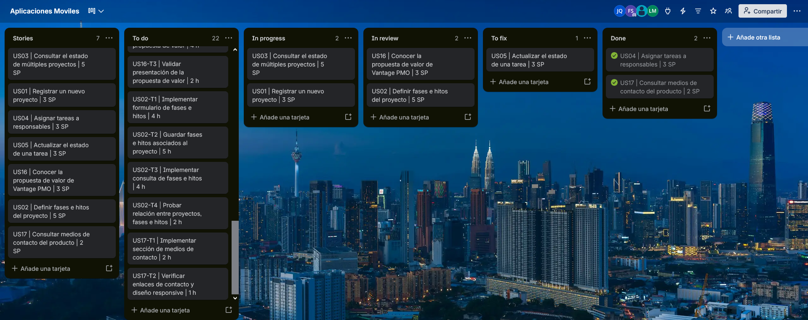
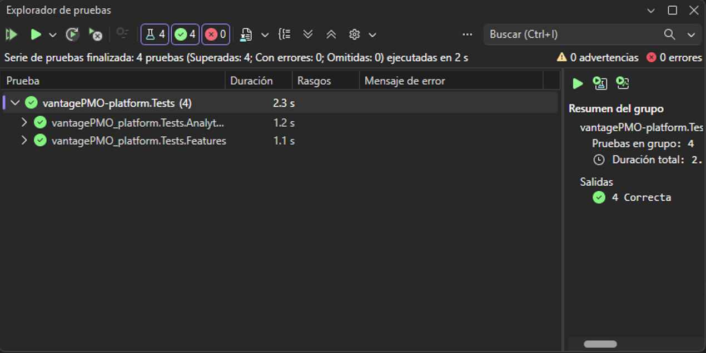
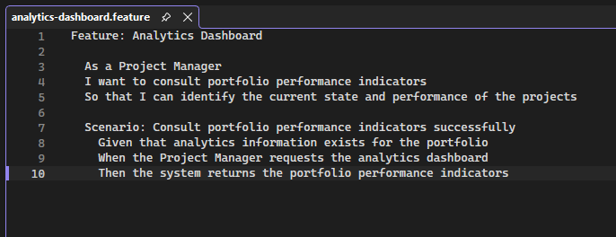
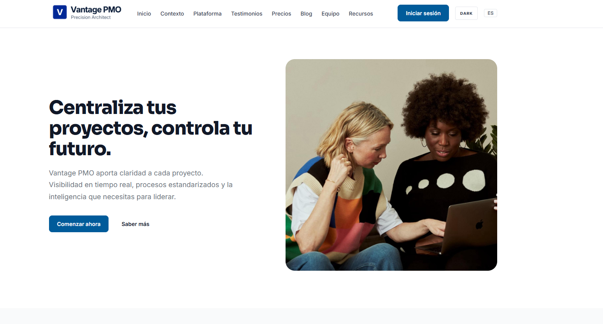
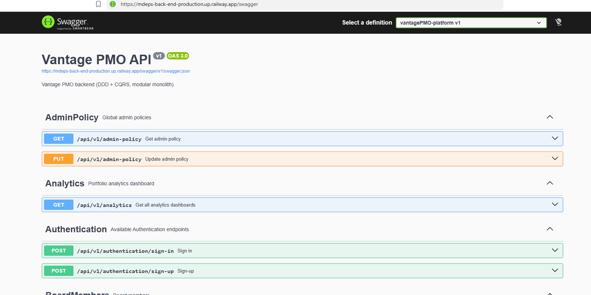
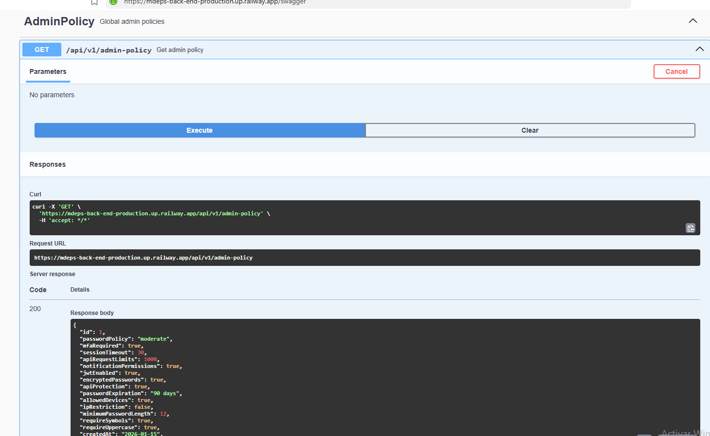

<div style="page-break-before: always;"></div>

# IV Product Implementation, Validation & Deployment

## 4.1. Software Configuration Management
<a id="5-1-software-configuration-management"></a>

### 4.1.1. Software Development Environment Configuration
<a id="5-1-1-software-development-environment-configuration"></a>

A continuación, se listan las herramientas y estándares adoptados por el equipo para el desarrollo colaborativo del sistema:

| Actividad               | Herramienta / Guía | Propósito                                                                    | Tipo de acceso / Ruta     |
| ----------------------- | --------------------------------------------------------------------------------------------------------------------------------------------------------------------------------- | ----------------------------------------------------------------------------- | ------------------------------------------------------------------------------------------------------------------------------------------------------------------------------------------------------------------- |
| Project Management      | Trello Software   | Seguimiento de backlog, tareas y sprints.                                     | SaaS –[https://trello.com/](https://trello.com/software/jira)          |
| Requirements Management | Gherkin Conventions   | Escritura legible de requisitos con formato Given/When/Then.                  | [https://cucumber.io/docs/gherkin/](https://cucumber.io/docs/gherkin/)          |
| Product UX/UI Design    | Figma   | Prototipos y diseño responsive.                                              | SaaS –[https://figma.com](https://figma.com)     |
| Landing Page             | HTML, CSS, JavaScript, Vue     | Construcción de la interfaz web.                                             | [https://vuejs.org/guide/introduction.html](https://vuejs.org/guide/introduction.html)       |
| User Personas, Empathy Journey Mapping, Impact Mapping   | UXPressia                | Es una herramienta en línea para el mapeo de la trayectoria del cliente que crea mapas de impacto y personas.    | [https://uxpressia.com/](https://uxpressia.com/)        |
| Class Diagram and Database Diagram  | LucidChart | Organización y modelado de las tablas y entidades del proyecto.         | [https://www.lucidchart.com/](https://www.lucidchart.com/)                                                                            |
| Code Standards          | Google HTML/CSS Style Guide, Vue Style Guide, MDN Guidelines, W3C JavaScript Style Guide, Google JavaScript Style Guide, C# Coding Conventions, Microsoft ASP.NET Core Guidelines | Aplicación de buenas prácticas de desarrollo en frontend y backend.         | [https://developer.mozilla.org/](https://developer.mozilla.org/) / [https://learn.microsoft.com/en-us/dotnet/csharp/fundamentals/coding-style](https://learn.microsoft.com/en-us/dotnet/csharp/fundamentals/coding-style) |
| Version Control         | Git + GitHub     | Control de versiones y trabajo colaborativo.                                  | SaaS –[https://github.com](https://github.com)  |
| Software Deployment     | Github pages   | Despliegue continuo de la aplicación para ambientes de prueba y validación. | SaaS –[https://railway.app](https://railway.app) / [https://render.com](https://render.com)  |
| Upgrade of Branches and Commits | Visual Studio Code | Optimización y documentación del proyecto asimismo el trabajo colaborativo. |[https://code.visualstudio.com/](https://code.visualstudio.com/)  |
| EventStorming | Miro | Herramienta colaborativa grupal que permitio diseñar mejor algunos puntos del trabajo. |[https://miro.com/es/](https://miro.com/es/)  |

<div style="text-align: left; max-width: 900px; margin: 0 auto;">

### 4.1.2. Source Code Management
<a id="5-1-2-source-code-management"></a>

Para la gestión del código del proyecto, el equipo adoptó una estrategia simplificada en lugar de implementar completamente el modelo Git Flow. Se trabajó principalmente sobre una rama principal (main), la cual contiene la versión estable y actual del sistema en desarrollo. 

Adicionalmente, se crearon algunas ramas específicas organizadas por capítulos del proyecto. Estas ramas permitieron desarrollar avances de manera más ordenada antes de integrarlos a la rama principal, sin llegar a una estructura compleja de múltiples ramas por funcionalidades o versiones. 

Todas las funcionalidades y mejoras fueron finalmente integradas en la rama main, asegurando que esta siempre represente el estado más actualizado del proyecto. Este enfoque, aunque más sencillo que Git Flow, resultó adecuado para el alcance del trabajo, ya que facilitó el control del progreso sin generar una sobrecarga en la gestión de ramas.

 Por otro lado, se utilizó GitHub como repositorio central del proyecto, aprovechando también herramientas como GitHub Pages para la visualización del Landing Page. Esto permitió desplegar rápidamente los avances en formato web y contar con una versión accesible del sistema de manera ágil y eficiente.

---

URL de los Repositorios:
Organización: https://github.com/MDEPS-Team
Reporte: https://github.com/MDEPS-Team/MDEPS-Landing-page
Landing Page: https://github.com/MDEPS-Team/MDEPS-Landing-page
Backend: https://github.com/MDEPS-Team/MDEPS-Back-End


### Versionado Semántico

Se aplicará el esquema de **Semantic Versioning 2.0.0**, con el siguiente formato:

- **MAJOR**: Incompatibilidades en la API.
- **MINOR**: Nuevas funcionalidades sin romper compatibilidad.
- **PATCH**: Correcciones de errores menores y ajustes sin afectar funcionalidades.

_Ejemplo de versión:_ `v1.3.4`

### Convenciones de Commits

Se adoptará el estándar de **Conventional Commits** para la redacción de los mensajes de commit, lo cual permitirá estructurar mejor los cambios realizados. Este enfoque facilita la automatización de procesos como la integración continua y la generación de historiales de cambios (changelogs).

**Ejemplos:**

- `feat: add project creation form`
- `fix: resolve error in task assignment module`
- `docs: update user stories and diagrams`
- `chore: update dependencies`
### 4.1.3. Source Code Style Guide & Conventions
<a id="5-1-3-source-code-style-guide-conventions"></a>

El código desarrollado por los miembros del equipo esté completamente redactado en inglés.

## **HTML**

* **Use Lowercase Element Names**: Se recomienda utilizar minúsculas para todos los elementos HTML.
```html
<section class="hero">
<h1>Centralize your projects</h1>
</section>

**Close All HTML Elements**: Todos los elementos deben cerrarse correctamente para evitar errores de renderizado.
```html
<p>Centralize your projects, control your future.</p>

<a href="#Contact">Solicitar demo</a>
```

**Use Lowercase Attribute Names**: Los atributos deben escribirse en minúsculas.

```html
<input type="email" placeholder="tu@correo.com" id="fe"/>
```
**Use Semantic HTML Elements**: Se deben utilizar etiquetas semánticas para mejorar la estructura y accesibilidad.

```html
<nav>...</nav>
<section id="funciones">...</section>
<footer>...</footer>
```

**Use Descriptive IDs and Classes**: Los nombres deben ser claros y representar su función.
```html
<section id="contact">
  <div class="contact-form">
```
## **CSS**

**Use Kebab-Case for Class Names**: Las clases deben escribirse en minúsculas separadas por guiones.
```css
.contact-form {
  display: flex;
}
```
**Use CSS Variables for Colors**: Se deben definir colores reutilizables en :root.
```css
:root {
  --blue: #1E40AF;
  --navy: #0F172A;
}
```
**Group Styles by Sections**: El código CSS debe organizarse por secciones del sitio.
```css
/* NAV */
nav { ... }
/* HERO */
.hero { ... }
/* FOOTER */
footer { ... }
```
**Use Consistent Spacing**: Se debe mantener consistencia en márgenes, padding y alineación.
```css
.section {
  padding: 6rem 2rem;
}
```
**Responsive Design with Media Queries**: Se deben usar breakpoints para adaptar la interfaz.
```css
@media (max-width: 600px) {
  .hero {
    padding: 4rem 1rem;
  }
}
```
## **JavaScript**

**Use CamelCase for Variables and Functions**: Las variables y funciones deben usar camelCase.
```js
function sendForm() {
  const userName = document.getElementById('fn').value;
}
```
**Keep Functions Simple and Clear**: Las funciones deben ser cortas y fáciles de entender.
```js
if (!n || !e) {
  alert('Por favor completa tu nombre y correo.');
  return;
}
```

**Use Meaningful Variable Names**: Los nombres deben representar su propósito.
```js
const navLinks = document.getElementById('navLinks');
const hamburger = document.getElementById('hamburger');
```
**Avoid Inline JavaScript**: Se recomienda mantener la lógica separada del HTML.
```js
< button onclick="sendForm()">Enviar</ button>
```
### 4.1.4. Software Deployment Configuration
<a id="5-1-4-software-deployment-configuration"></a>

Para la Landing Page desarrollada en HTML, CSS y JavaScript, la configuración del despliegue en GitHub Pages se define de la siguiente manera:

**Repositorio de Código Fuente**

Se debe crear un repositorio en GitHub y subir todos los archivos del proyecto (HTML, CSS, JS). Es obligatorio que el archivo index.html esté ubicado en la raíz del repositorio para poder realizar el despliegue correctamente.


**Despliegue del Backend (Web Service)**

Para el despliegue de la API REST y la base de datos, se utilizó la plataforma **Railway**. El proceso de configuración consistió en:
1. Provisión de un servicio de base de datos **MySQL** alojado en la nube.
2. Vinculación directa con el repositorio de GitHub (`MDEPS-Back-End`) utilizando el archivo `Dockerfile` ubicado en la raíz del proyecto para la compilación del entorno en .NET 10.
3. Configuración de variables de entorno, incluyendo la cadena de conexión a la base de datos (`ConnectionStrings__DefaultConnection`) y la habilitación de la documentación pública (`ASPNETCORE_ENVIRONMENT = Development`).
# 4.2
## 4.2.1. Sprint 1
##### 4.2.1.1. Sprint Planning 1

En esta sección, se presenta la planificación correspondiente al Sprint 1 de Vantage PMO.

| Sprint | User Stories previstas en el Product Backlog | Story Points |
| :--- | :--- | :---: |
| Sprint 1 | US03, US01, US04, US05, US16, US02, US17 | 24 |
| Sprint 2 | US11, US12, US13, US07, US09 | 28 |
| Sprint 3 | US08, US14, US06, US10, US15 | 26 |

| **Sprint #** | **Sprint 1** |
|--------------|--------------|
| **Sprint Planning Background** | |
| **Date** | [08/10/2026] |
| **Time** | [13:00] |
| **Location** | [zoom] |
| **Prepared By** | Fuentes Alvarez, Angiela Stephany |
| **Attendees** | Fuentes Alvarez, Angiela Stephany / Guillen Giraldo, Mike Dylan / Mendoza Machoa, Lionel Snayder / Pacheco Lavado, Rafael Agustin / Quiliano Motta, Kirk Douglas |
| **Sprint n-1 Review Summary** | No aplica |
| **Sprint n-1 Retrospective Summary** | No aplica |
| **Sprint Goal & User Stories** | |
| **Sprint 1** | El objetivo del Sprint 1 es transformar los requerimientos y hallazgos obtenidos durante las etapas de análisis en propuestas concretas de diseño y planificación para Vantage PMO. Durante este sprint, el equipo trabajará en la elaboración de los Wireframes y Mock-ups del Landing Page, el diseño UX/UI de la aplicación móvil, la definición de los flujos de usuario y el desarrollo del prototipo, buscando mantener coherencia con las necesidades identificadas en los segmentos objetivo y con los artefactos desarrollados previamente. |
| **Sprint 1 Velocity** | [24 Story Points] |
| **Sum of Story Points** | 24 Story Points |
##### 4.2.1.2. Aspect Leaders and Collaborators

En el marco del Sprint 1, se han priorizado las actividades relacionadas con la transformación de los requerimientos y hallazgos obtenidos durante las etapas de análisis en propuestas concretas de diseño y planificación para Vantage PMO. Los esfuerzos del equipo se orientan hacia el diseño de la Landing Page, el diseño UX/UI de la aplicación móvil, la elaboración de flujos de usuario y prototipos, así como las actividades relacionadas con la implementación y documentación de la solución.

A fin de garantizar una ejecución coordinada y una adecuada distribución de responsabilidades, se ha implementado la Matriz de Liderazgo y Colaboración (LACX). En esta herramienta se identifican los responsables principales (L) y los colaboradores (C) para cada aspecto del Sprint 1.

| **Team Member (Last Name, First Name)** | **GitHub Username** | **Landing Page** | **Mobile App UX/UI** | **User Flows & Prototyping** | **Implementation** | **Testing** | **Documentation** |
| ---------------------------------------- | ------------------- | ---------------- | -------------------- | ----------------------------- | ------------------ | ----------- | ---------------- |
| Fuentes Alvarez, Angiela Stephany | angielafuentes | L | C | C | C | C | L |
| Guillen Giraldo, Mike Dylan | FullHous | C | L | C | C | C | C |
| Mendoza Machoa, Lionel Snayder | mendozalionel745-ctrl | C | C | L | C | C | C |
| Pacheco Lavado, Rafael Agustin | RafaelAgustin21 | C | C | C | L | C | C |
| Quiliano Motta, Kirk Douglas | Kirkcito | C | C | C | C | L | C |

##### 4.2.1.3. Sprint Backlog 1

El Sprint Backlog 1 reúne las historias de usuario y actividades priorizadas por el equipo para el desarrollo del Sprint 1 de Vantage PMO. El trabajo está orientado a transformar los requerimientos y necesidades identificados durante las etapas anteriores en propuestas concretas de diseño, planificación y desarrollo de la solución.

Durante este sprint se consideran actividades relacionadas con el diseño de la Landing Page, el desarrollo de la experiencia UX/UI de la aplicación móvil, la elaboración de Wireflows y User Flows, la creación de Mock-ups, el desarrollo del prototipo y las funcionalidades correspondientes a las historias de usuario seleccionadas.

Las actividades de diseño UX/UI y prototipado de la aplicación se consideran tareas complementarias de apoyo al desarrollo del producto, por lo que no cuentan con un identificador de User Story específico en el Product Backlog.

**Screenshot del Board**



*Trello:* [Aplicaciones Móviles](https://trello.com/b/Gzag7ZlN/aplicaciones-moviles)

<table border="1" cellspacing="0" cellpadding="5">
  <tr>
    <th>Sprint #</th>
    <th colspan="7">Sprint 01</th>
  </tr>
  <tr>
    <th colspan="2">User Story</th>
    <th colspan="2">Work-item / Task</th>
    <th colspan="4"></th>
  </tr>
  <tr>
    <th>ID</th>
    <th>Title</th>
    <th>ID</th>
    <th>Title</th>
    <th>Description</th>
    <th>Estimation (hours)</th>
    <th>Assigned To</th>
    <th>Status</th>
  </tr>
  <tr>
    <td>US16</td>
    <td>Conocer la propuesta de valor de Vantage PMO</td>
    <td>T001</td>
    <td>Elaboración de Wireframes</td>
    <td>Diseñar la estructura visual y organización de contenidos del Landing Page considerando las necesidades identificadas durante el proceso de análisis.</td>
    <td>4 h</td>
    <td>Fuentes Alvarez, Angiela Stephany</td>
    <td>Listo</td>
  </tr>
  <tr>
    <td></td>
    <td></td>
    <td>T002</td>
    <td>Elaboración de Mock-ups</td>
    <td>Desarrollar los Mock-ups del Landing Page aplicando los lineamientos visuales y de experiencia de usuario definidos para Vantage PMO.</td>
    <td>5 h</td>
    <td>Guillen Giraldo, Mike Dylan</td>
    <td>Listo</td>
  </tr>
  <tr>
    <td>—</td>
    <td>Diseño UX/UI de la Aplicación Móvil</td>
    <td>T003</td>
    <td>Elaboración de Wireframes</td>
    <td>Diseñar los Wireframes de la aplicación móvil considerando los User Personas y las necesidades identificadas durante el proceso de Needfinding.</td>
    <td>5 h</td>
    <td>Mendoza Machoa, Lionel Snayder</td>
    <td>Listo</td>
  </tr>
  <tr>
    <td></td>
    <td></td>
    <td>T004</td>
    <td>Elaboración de Wireflow Diagrams</td>
    <td>Definir los flujos de interacción de la aplicación mediante Wireflows asociados a los principales objetivos de los usuarios.</td>
    <td>4 h</td>
    <td>Pacheco Lavado, Rafael Agustin</td>
    <td>Listo</td>
  </tr>
  <tr>
    <td></td>
    <td></td>
    <td>T005</td>
    <td>Elaboración de Mock-ups</td>
    <td>Desarrollar los Mock-ups de la aplicación móvil incorporando los principios de diseño, arquitectura de información y lineamientos visuales definidos.</td>
    <td>6 h</td>
    <td>Quiliano Motta, Kirk Douglas</td>
    <td>Listo</td>
  </tr>
  <tr>
    <td></td>
    <td></td>
    <td>T006</td>
    <td>Elaboración de User Flow Diagrams</td>
    <td>Representar los flujos de interacción esperados para los principales objetivos de los usuarios, incluyendo los caminos principales y alternativos.</td>
    <td>4 h</td>
    <td>Fuentes Alvarez, Angiela Stephany</td>
    <td>Listo</td>
  </tr>
  <tr>
    <td>—</td>
    <td>Prototipado de la Aplicación</td>
    <td>T007</td>
    <td>Desarrollo del prototipo</td>
    <td>Integrar los Mock-ups y flujos definidos para construir un prototipo navegable que permita validar la experiencia propuesta.</td>
    <td>8 h</td>
    <td>Mendoza Machoa, Lionel Snayder</td>
    <td>Listo</td>
  </tr>
  <tr>
    <td>US01</td>
    <td>Registrar un nuevo proyecto</td>
    <td>T008</td>
    <td>Diseño del formulario de registro</td>
    <td>Definir los campos y elementos de interfaz necesarios para registrar un nuevo proyecto.</td>
    <td>3 h</td>
    <td>Quiliano Motta, Kirk Douglas</td>
    <td>Listo</td>
  </tr>
  <tr>
    <td></td>
    <td></td>
    <td>T009</td>
    <td>Desarrollo del registro de proyectos</td>
    <td>Implementar la funcionalidad de registro de proyectos y las validaciones correspondientes.</td>
    <td>5 h</td>
    <td>Guillen Giraldo, Mike Dylan</td>
    <td>Listo</td>
  </tr>
  <tr>
    <td>US02</td>
    <td>Definir fases e hitos del proyecto</td>
    <td>T010</td>
    <td>Diseño de fases e hitos</td>
    <td>Definir la estructura para organizar las fases y los hitos asociados a cada proyecto.</td>
    <td>3 h</td>
    <td>Pacheco Lavado, Rafael Agustin</td>
    <td>Listo</td>
  </tr>
  <tr>
    <td></td>
    <td></td>
    <td>T011</td>
    <td>Gestión de fases e hitos</td>
    <td>Implementar las operaciones necesarias para registrar y administrar las fases e hitos de un proyecto.</td>
    <td>5 h</td>
    <td>Fuentes Alvarez, Angiela Stephany</td>
    <td>Listo</td>
  </tr>
  <tr>
    <td>US03</td>
    <td>Consultar el estado de múltiples proyectos</td>
    <td>T012</td>
    <td>Diseño de vista del portafolio</td>
    <td>Diseñar una vista que permita visualizar información general y estados de los proyectos registrados.</td>
    <td>3 h</td>
    <td>Guillen Giraldo, Mike Dylan</td>
    <td>Listo</td>
  </tr>
  <tr>
    <td></td>
    <td></td>
    <td>T013</td>
    <td>Consulta de proyectos</td>
    <td>Implementar la consulta y presentación del estado de múltiples proyectos del portafolio.</td>
    <td>5 h</td>
    <td>Quiliano Motta, Kirk Douglas</td>
    <td>Listo</td>
  </tr>
  <tr>
    <td>US04</td>
    <td>Asignar tareas a responsables</td>
    <td>T014</td>
    <td>Diseño de asignación de tareas</td>
    <td>Definir los elementos necesarios para seleccionar tareas y asociarlas con sus responsables.</td>
    <td>2 h</td>
    <td>Mendoza Machoa, Lionel Snayder</td>
    <td>Listo</td>
  </tr>
  <tr>
    <td></td>
    <td></td>
    <td>T015</td>
    <td>Implementación de asignaciones</td>
    <td>Implementar la funcionalidad para asignar tareas a los integrantes responsables del proyecto.</td>
    <td>4 h</td>
    <td>Pacheco Lavado, Rafael Agustin</td>
    <td>Listo</td>
  </tr>
  <tr>
    <td>US05</td>
    <td>Actualizar el estado de una tarea</td>
    <td>T016</td>
    <td>Definición de estados de tareas</td>
    <td>Definir los estados y transiciones que podrá presentar una tarea durante su ciclo de trabajo.</td>
    <td>2 h</td>
    <td>Fuentes Alvarez, Angiela Stephany</td>
    <td>Listo</td>
  </tr>
  <tr>
    <td></td>
    <td></td>
    <td>T017</td>
    <td>Actualización del estado de tareas</td>
    <td>Implementar la funcionalidad para actualizar y consultar el estado de las tareas.</td>
    <td>4 h</td>
    <td>Guillen Giraldo, Mike Dylan</td>
    <td>Listo</td>
  </tr>
  <tr>
    <td>US16</td>
    <td>Conocer la propuesta de valor de Vantage PMO</td>
    <td>T018</td>
    <td>Organización de la propuesta de valor</td>
    <td>Organizar los contenidos que comuniquen los beneficios y principales características de Vantage PMO.</td>
    <td>2 h</td>
    <td>Mendoza Machoa, Lionel Snayder</td>
    <td>Listo</td>
  </tr>
  <tr>
    <td></td>
    <td></td>
    <td>T019</td>
    <td>Integración de contenidos en Landing Page</td>
    <td>Incorporar la propuesta de valor y sus contenidos en la estructura de la Landing Page.</td>
    <td>3 h</td>
    <td>Pacheco Lavado, Rafael Agustin</td>
    <td>Listo</td>
  </tr>
  <tr>
    <td>US17</td>
    <td>Consultar medios de contacto del producto</td>
    <td>T020</td>
    <td>Diseño de sección de contacto</td>
    <td>Definir la estructura visual de la sección destinada a presentar los medios de contacto del producto.</td>
    <td>2 h</td>
    <td>Quiliano Motta, Kirk Douglas</td>
    <td>Listo</td>
  </tr>
  <tr>
    <td></td>
    <td></td>
    <td>T021</td>
    <td>Integración de medios de contacto</td>
    <td>Incorporar los medios de contacto disponibles en la Landing Page de Vantage PMO.</td>
    <td>3 h</td>
    <td>Fuentes Alvarez, Angiela Stephany</td>
    <td>Listo</td>
  </tr>
</table>
  
### 4.2.1.4. Development Evidence for Sprint Review

Durante el Sprint 1 se realizaron avances en la implementación de los productos que conforman Vantage PMO. Como parte del desarrollo, se avanzó en la construcción de los servicios del backend, incorporando la estructura necesaria para gestionar las principales capacidades del dominio mediante servicios RESTful.

El código fuente se mantiene en repositorios de GitHub, utilizando control de versiones para registrar los cambios realizados durante la implementación. En el backend se incorporaron componentes correspondientes a las capas de dominio, aplicación, infraestructura e interfaces REST, permitiendo establecer la base para las funcionalidades definidas para el Sprint 1.

A continuación, se presentan los commits asociados a los avances de implementación realizados durante el Sprint.

| Repository | Branch | Commit Id | Commit Message | Commit Message Body | Commited on (Date) |
| :--- | :--- | :--- | :--- | :--- | :--- |
| [MDEPS-Team/MDEPS-Back-End](https://github.com/MDEPS-Team/MDEPS-Back-End) | main | 062e857 | feat: backend migration | — | 2026-10-04 |

El commit presentado corresponde a la incorporación de la implementación inicial del backend de Vantage PMO, incluyendo la estructura de los diferentes módulos del dominio y los servicios REST necesarios para exponer las funcionalidades del sistema.

### 4.2.1.5. Testing Suite Evidence for Sprint Review

Durante el Sprint 1 se implementó una suite de pruebas automatizadas para validar parte de las funcionalidades del backend de Vantage PMO. Las pruebas fueron desarrolladas utilizando **xUnit** sobre **.NET 10**, incorporando pruebas unitarias, una prueba de integración y una prueba de aceptación bajo el enfoque BDD.

Las pruebas realizadas se encuentran relacionadas principalmente con la **US11 - Consultar indicadores de desempeño**, debido a que validan componentes pertenecientes al bounded context de Analytics, encargado de gestionar y proporcionar información relacionada con los indicadores de desempeño del portafolio.

La suite desarrollada permitió verificar tanto el comportamiento de objetos individuales del dominio como la interacción entre componentes de persistencia y la correcta satisfacción de un escenario de aceptación definido mediante Gherkin.

#### Unit Tests

Para las pruebas unitarias se seleccionaron objetos de valor pertenecientes al módulo Analytics. El objetivo fue comprobar que los objetos mantengan correctamente la información proporcionada durante su creación.

| Test ID | Test Type | Related User Story | Class | Test | Description |
| :--- | :--- | :--- | :--- | :--- | :--- |
| UT01 | Unit Test | US11 | `SummaryKpis` | `Constructor_ShouldAssignProvidedValues` | Verifica que los valores correspondientes a fondos disponibles, índice de velocidad, exposición al riesgo y planes de mitigación sean asignados correctamente al crear un objeto `SummaryKpis`. |
| UT02 | Unit Test | US11 | `PortfolioRoi` | `Constructor_ShouldAssignProvidedValues` | Verifica que el porcentaje de ROI, nivel de eficiencia, valor objetivo y valor proyectado sean almacenados correctamente en un objeto `PortfolioRoi`. |

Estas pruebas permiten validar de manera aislada los objetos utilizados para representar los principales indicadores de desempeño mostrados por el módulo Analytics.

#### Integration Tests

Para validar la interacción entre la capa de persistencia y el dominio se implementó una prueba de integración utilizando **Entity Framework Core InMemory**.

| Test ID | Test Type | Related User Story | Component | Test | Description |
| :--- | :--- | :--- | :--- | :--- | :--- |
| IT01 | Integration Test | US11 | `AnalyticsDashboardRepository` | `AddAndList_ShouldPersistAndReturnAnalyticsDashboard` | Verifica que un objeto `AnalyticsDashboard` pueda almacenarse mediante el repositorio y posteriormente recuperarse correctamente, conservando sus indicadores y datos asociados. |

La prueba utiliza una base de datos en memoria para verificar la integración entre `AppDbContext`, Entity Framework Core y `AnalyticsDashboardRepository`, evitando modificar la base de datos utilizada por la aplicación durante el desarrollo.

#### Acceptance Tests

Para validar el comportamiento esperado desde la perspectiva del usuario se implementó un Acceptance Test bajo el enfoque **Behavior-Driven Development (BDD)**.

El escenario se relaciona con la **US11 - Consultar indicadores de desempeño**, donde el Project Manager debe poder consultar los indicadores correspondientes al desempeño del portafolio.

El escenario fue definido mediante un archivo `.feature` utilizando Gherkin:

```gherkin
Feature: Analytics Dashboard

  As a Project Manager
  I want to consult portfolio performance indicators
  So that I can identify the current state and performance of the projects

  Scenario: Consult portfolio performance indicators successfully
    Given that analytics information exists for the portfolio
    When the Project Manager requests the analytics dashboard
    Then the system returns the portfolio performance indicators
```

Los Steps correspondientes fueron implementados en la clase `AnalyticsDashboardSteps`. En el paso `Given` se prepara información de Analytics utilizando una base de datos en memoria; en el paso `When` se consulta la información mediante `AnalyticsDashboardRepository`; finalmente, en el paso `Then` se verifica que el sistema retorne correctamente los indicadores de desempeño esperados.

| Test ID | Test Type | Related User Story | Feature | Scenario |
| :--- | :--- | :--- | :--- | :--- |
| AT01 | Acceptance Test - BDD | US11 | Analytics Dashboard | Consult portfolio performance indicators successfully |

#### Testing Execution Evidence

La ejecución de la suite de pruebas fue realizada mediante el Test Explorer de Visual Studio. Como resultado se ejecutaron cuatro pruebas automatizadas, obteniendo los siguientes resultados:

| Test Type | Tests Executed | Passed | Failed |
| :--- | :---: | :---: | :---: |
| Unit Tests | 2 | 2 | 0 |
| Integration Tests | 1 | 1 | 0 |
| Acceptance Tests | 1 | 1 | 0 |
| **Total** | **4** | **4** | **0** |

La ejecución confirmó que las cuatro pruebas implementadas finalizaron correctamente, sin presentar errores ni pruebas omitidas.



*Figura. Ejecución de la suite de pruebas del backend de Vantage PMO en Visual Studio, mostrando cuatro pruebas superadas y cero errores.*

Asimismo, la siguiente evidencia muestra el escenario de aceptación definido mediante Gherkin para la consulta de indicadores de desempeño.



*Figura. Escenario de Acceptance Test en Gherkin correspondiente a la US11 - Consultar indicadores de desempeño.*

#### Testing Repository and Commits

Los archivos correspondientes a las pruebas automatizadas se encuentran almacenados dentro del repositorio del backend de Vantage PMO, en el proyecto `vantagePMO-platform.Tests`.

**Repository:** [MDEPS-Team/MDEPS-Back-End](https://github.com/MDEPS-Team/MDEPS-Back-End)

Los principales archivos incorporados para la suite de pruebas son:

- `vantagePMO-platform.Tests/SummaryKpisTests.cs`
- `vantagePMO-platform.Tests/PortfolioRoiTests.cs`
- `vantagePMO-platform.Tests/AnalyticsDashboardRepositoryIntegrationTests.cs`
- `vantagePMO-platform.Tests/Features/analytics-dashboard.feature`
- `vantagePMO-platform.Tests/Features/Steps/AnalyticsDashboardSteps.cs`
- `vantagePMO-platform.Tests/vantagePMO-platform.Tests.csproj`

A continuación, se presenta el commit relacionado con la implementación de las pruebas durante el Sprint 1.

| Repository | Branch | Commit Id | Commit Message | Commit Message Body | Commited on (Date) |
| :--- | :--- | :--- | :--- | :--- | :--- |
| MDEPS-Team/MDEPS-Back-End | feature/4.2.1.5-testing | ff70649 | test: add sprint 1 backend test suite | — | 2026-10-05 |

### 4.2.1.6. Execution Evidence for Sprint Review
<a id="5-2-1-5-execution-evidence-for-sprint-review"></a>

Durante el presente Sprint, se ha logrado la transición de una interfaz estática a un ecosistema interactivo y funcional, cumpliendo con el objetivo de establecer el núcleo de acceso y la propuesta de valor visual de Vantage PMO. Los hitos alcanzados se centran en la implementación de un sistema de seguridad robusto, la personalización dinámica de la identidad de marca y la optimización de la experiencia de usuario a través de múltiples dispositivos y lenguajes.

**Resumen de Logros:**

- Seguridad y Acceso: Se ha desplegado un módulo de autenticación completo que integra proveedores de identidad modernos, garantizando un flujo de inicio de sesión seguro, validado y alineado con normativas legales de privacidad.

- Interactividad y Demostración: Se implementó un motor de previsualización en tiempo real que permite a los potenciales clientes interactuar con la plataforma, personalizando elementos de branding y visualizando la capacidad del dashboard de portafolio sin fricciones técnicas.

- Accesibilidad y Alcance Global: Gracias a la implementación de internacionalización (i18n) y un diseño estrictamente responsivo, la plataforma es ahora capaz de ofrecer una navegación coherente y profesional tanto en entornos de escritorio como en dispositivos móviles, eliminando barreras de idioma y formato.

- Comunicación Persistente: Se estableció la infraestructura de notificaciones push, permitiendo una conexión directa con el usuario y mejorando los índices de retención mediante alertas del sistema optimizadas.

A continuación, se presentan las evidencias gráficas de las vistas implementadas y el recurso audiovisual que detalla el flujo de navegación alcanzado:

Video de Demostración y Navegación: https://upcedupe-my.sharepoint.com/:v:/g/personal/u202417433_upc_edu_pe/IQBngnzzXajyRpPAik2w-PdQAW6q0V01RTT5qhqPQLRNLcg?nav=eyJyZWZlcnJhbEluZm8iOnsicmVmZXJyYWxBcHAiOiJPbmVEcml2ZUZvckJ1c2luZXNzIiwicmVmZXJyYWxBcHBQbGF0Zm9ybSI6IldlYiIsInJlZmVycmFsTW9kZSI6InZpZXciLCJyZWZlcnJhbFZpZXciOiJNeUZpbGVzTGlua0NvcHkifX0&e=SXvFNG

Screenshots de la Implementación:



**Ejecución e Interactividad del Backend**

Además del entorno web, se logró desplegar exitosamente el backend de Vantage PMO basado en arquitectura DDD y CQRS. A través de la interfaz interactiva de Swagger, se demostró la ejecución real de los Endpoints de los distintos Bounded Contexts (Authentication, Projects, Analytics, etc.).

Durante la validación, se ejecutaron peticiones `POST` para la creación de entidades y peticiones `GET` para verificar su correcta persistencia en la base de datos MySQL alojada en Railway, confirmando que la API no retorna datos simulados, sino que procesa transacciones reales.


*Figura: Interfaz interactiva de Swagger documentando los Bounded Contexts del sistema.*


*Figura: Ejecución de un endpoint de la API y respuesta HTTP validando la persistencia en la base de datos.*

### 4.2.1.7. Services Documentation Evidence for Sprint Review
### 4.2.1.8. Software Deployment Evidence for Sprint Review
### 4.2.1.9. Team Collaboration Insights during Sprint


## 4.2.2. Sprint 2

##### 4.2.2.1. Sprint Planning 2

En esta sección se presenta la planificación correspondiente al Sprint 2 de Vantage PMO.

| Sprint | User Stories previstas en el Product Backlog | Story Points |
| :--- | :--- | :---: |
| Sprint 1 | US03, US01, US04, US05, US16, US02, US17 | 24 |
| Sprint 2 | US07, US09, US11, US12, US13 | 28 |
| Sprint 3 | US08, US14, US06, US10, US15 | 26 |

| **Sprint #** | **Sprint 2** |
| :--- | :--- |
| **Sprint Planning Background** | Continuación del desarrollo de las funcionalidades de gestión y seguimiento de Vantage PMO. |
| **Date** | [Fecha real del Sprint Planning] |
| **Time** | [Hora real] |
| **Location** | [Lugar o plataforma utilizada] |
| **Prepared By** | Fuentes Alvarez, Angiela Stephany |
| **Attendees** | Fuentes Alvarez, Angiela Stephany / Guillen Giraldo, Mike Dylan / Mendoza Machoa, Lionel Snayder / Pacheco Lavado, Rafael Agustin / Quiliano Motta, Kirk Douglas |
| **Sprint n-1 Review Summary** | [Resumen de la revisión del Sprint 1] |
| **Sprint n-1 Retrospective Summary** | [Resumen de la retrospectiva del Sprint 1] |
| **Sprint Goal & User Stories** | |
| **Sprint 2** | El objetivo del Sprint 2 es fortalecer las capacidades de gestión, seguimiento y análisis de Vantage PMO. Durante este sprint se trabajará en el registro y seguimiento de riesgos, la centralización de documentos, la consulta de indicadores de desempeño, la generación de reportes y la recepción de alertas sobre eventos relevantes. Estas funcionalidades buscan mejorar el control de los proyectos y facilitar la toma de decisiones mediante información organizada y oportuna. |
| **Sprint 2 Velocity** | [Por determinar] |
| **Sum of Story Points** | 28 Story Points |

##### 4.2.2.2. Sprint Backlog 2

El Sprint Backlog 2 reúne las historias de usuario y actividades seleccionadas para el segundo sprint de Vantage PMO. Las tareas están orientadas al desarrollo de funcionalidades que permitan gestionar riesgos, centralizar documentos, consultar indicadores, generar reportes y recibir notificaciones relevantes.

Durante este sprint se consideran actividades de diseño, desarrollo y validación de las funcionalidades relacionadas con el control y seguimiento de proyectos, así como la organización y presentación de información para apoyar la toma de decisiones.

**Trello:** [Aplicaciones Móviles](https://trello.com/b/Gzag7ZlN/aplicaciones-moviles)

<table border="1" cellspacing="0" cellpadding="5">
  <tr>
    <th>Sprint #</th>
    <th colspan="7">Sprint 02</th>
  </tr>
  <tr>
    <th colspan="2">User Story</th>
    <th colspan="2">Work-item / Task</th>
    <th colspan="4"></th>
  </tr>
  <tr>
    <th>ID</th>
    <th>Title</th>
    <th>ID</th>
    <th>Title</th>
    <th>Description</th>
    <th>Estimation (hours)</th>
    <th>Assigned To</th>
    <th>Status</th>
  </tr>
  <tr>
    <td>US07</td>
    <td>Registrar y realizar seguimiento de riesgos</td>
    <td>T022</td>
    <td>Diseño del módulo de riesgos</td>
    <td>Definir la estructura y los campos necesarios para registrar riesgos asociados a los proyectos.</td>
    <td>4 h</td>
    <td>Fuentes Alvarez, Angiela Stephany</td>
    <td>Por confirmar</td>
  </tr>
  <tr>
    <td></td><td></td>
    <td>T023</td>
    <td>Implementación de gestión de riesgos</td>
    <td>Desarrollar las funcionalidades para registrar, consultar y actualizar los riesgos identificados en los proyectos.</td>
    <td>8 h</td>
    <td>Guillen Giraldo, Mike Dylan</td>
    <td>Por confirmar</td>
  </tr>
  <tr>
    <td>US09</td>
    <td>Centralizar documentos de los proyectos</td>
    <td>T024</td>
    <td>Diseño del repositorio documental</td>
    <td>Definir la estructura de organización y clasificación de los documentos asociados a cada proyecto.</td>
    <td>4 h</td>
    <td>Mendoza Machoa, Lionel Snayder</td>
    <td>Por confirmar</td>
  </tr>
  <tr>
    <td></td><td></td>
    <td>T025</td>
    <td>Implementación de gestión documental</td>
    <td>Desarrollar las operaciones necesarias para registrar, almacenar y consultar documentos de los proyectos.</td>
    <td>8 h</td>
    <td>Pacheco Lavado, Rafael Agustin</td>
    <td>Por confirmar</td>
  </tr>
  <tr>
    <td>US11</td>
    <td>Consultar indicadores de desempeño</td>
    <td>T026</td>
    <td>Diseño de indicadores de desempeño</td>
    <td>Definir los indicadores y elementos visuales necesarios para presentar información sobre el desempeño del portafolio.</td>
    <td>4 h</td>
    <td>Quiliano Motta, Kirk Douglas</td>
    <td>Por confirmar</td>
  </tr>
  <tr>
    <td></td><td></td>
    <td>T027</td>
    <td>Implementación de consulta de indicadores</td>
    <td>Desarrollar la consulta y presentación de indicadores de desempeño de los proyectos.</td>
    <td>8 h</td>
    <td>Fuentes Alvarez, Angiela Stephany</td>
    <td>Por confirmar</td>
  </tr>
  <tr>
    <td>US12</td>
    <td>Generar reportes de desempeño</td>
    <td>T028</td>
    <td>Diseño de estructura de reportes</td>
    <td>Definir la estructura y los datos que serán incluidos en los reportes de desempeño de los proyectos.</td>
    <td>4 h</td>
    <td>Guillen Giraldo, Mike Dylan</td>
    <td>Por confirmar</td>
  </tr>
  <tr>
    <td></td><td></td>
    <td>T029</td>
    <td>Desarrollo de generación de reportes</td>
    <td>Implementar la generación de reportes utilizando la información disponible de los indicadores y proyectos.</td>
    <td>10 h</td>
    <td>Mendoza Machoa, Lionel Snayder</td>
    <td>Por confirmar</td>
  </tr>
  <tr>
    <td>US13</td>
    <td>Recibir alertas sobre eventos relevantes</td>
    <td>T030</td>
    <td>Diseño de alertas y notificaciones</td>
    <td>Identificar los eventos relevantes y definir los criterios para generar alertas y notificaciones a los usuarios.</td>
    <td>4 h</td>
    <td>Pacheco Lavado, Rafael Agustin</td>
    <td>Por confirmar</td>
  </tr>
  <tr>
    <td></td><td></td>
    <td>T031</td>
    <td>Implementación de notificaciones</td>
    <td>Desarrollar la funcionalidad para generar y presentar alertas relacionadas con eventos relevantes de los proyectos.</td>
    <td>8 h</td>
    <td>Quiliano Motta, Kirk Douglas</td>
    <td>Por confirmar</td>
  </tr>
</table>


## 4.2.3. Sprint 3

##### 4.2.3.1. Sprint Planning 3

En esta sección se presenta la planificación correspondiente al Sprint 3 de Vantage PMO.

| Sprint | User Stories previstas en el Product Backlog | Story Points |
| :--- | :--- | :---: |
| Sprint 1 | US03, US01, US04, US05, US16, US02, US17 | 24 |
| Sprint 2 | US07, US09, US11, US12, US13 | 28 |
| Sprint 3 | US08, US14, US06, US10, US15 | 26 |

| **Sprint #** | **Sprint 3** |
| :--- | :--- |
| **Sprint Planning Background** | Continuación de la evolución de Vantage PMO mediante funcionalidades de colaboración, administración de recursos, acceso móvil y seguridad. |
| **Date** | [Fecha real del Sprint Planning] |
| **Time** | [Hora real] |
| **Location** | [Lugar o plataforma utilizada] |
| **Prepared By** | Fuentes Alvarez, Angiela Stephany |
| **Attendees** | Fuentes Alvarez, Angiela Stephany / Guillen Giraldo, Mike Dylan / Mendoza Machoa, Lionel Snayder / Pacheco Lavado, Rafael Agustin / Quiliano Motta, Kirk Douglas |
| **Sprint n-1 Review Summary** | [Resumen de la revisión del Sprint 2] |
| **Sprint n-1 Retrospective Summary** | [Resumen de la retrospectiva del Sprint 2] |
| **Sprint Goal & User Stories** | |
| **Sprint 3** | El objetivo del Sprint 3 es completar y fortalecer las funcionalidades de colaboración, administración de recursos y acceso seguro a Vantage PMO. Durante este sprint se trabajará en el registro de bloqueos y observaciones de tareas, la asignación de recursos según su capacidad, el registro de evidencias desde dispositivos, el acceso móvil a los proyectos y la administración de roles y permisos. Estas funcionalidades buscan mejorar la coordinación del equipo, la disponibilidad de información y el control de acceso al sistema. |
| **Sprint 3 Velocity** | [Por determinar] |
| **Sum of Story Points** | 26 Story Points |

##### 4.2.3.2. Sprint Backlog 3

El Sprint Backlog 3 reúne las historias de usuario y actividades seleccionadas para el tercer sprint de Vantage PMO. Las tareas se orientan a completar funcionalidades relacionadas con la colaboración entre integrantes, la administración de recursos, la captura de evidencias, el acceso desde dispositivos móviles y la gestión de permisos.

Durante este sprint se consideran actividades de diseño, desarrollo y validación que permitan fortalecer la experiencia de los usuarios y mejorar la administración de los proyectos.

**Trello:** [Aplicaciones Móviles](https://trello.com/b/Gzag7ZlN/aplicaciones-moviles)

<table border="1" cellspacing="0" cellpadding="5">
  <tr>
    <th>Sprint #</th>
    <th colspan="7">Sprint 03</th>
  </tr>
  <tr>
    <th colspan="2">User Story</th>
    <th colspan="2">Work-item / Task</th>
    <th colspan="4"></th>
  </tr>
  <tr>
    <th>ID</th>
    <th>Title</th>
    <th>ID</th>
    <th>Title</th>
    <th>Description</th>
    <th>Estimation (hours)</th>
    <th>Assigned To</th>
    <th>Status</th>
  </tr>
  <tr>
    <td>US08</td>
    <td>Asignar recursos considerando su capacidad</td>
    <td>T032</td>
    <td>Diseño del módulo de recursos</td>
    <td>Definir la estructura para registrar recursos y visualizar su disponibilidad y capacidad dentro de los proyectos.</td>
    <td>4 h</td>
    <td>Fuentes Alvarez, Angiela Stephany</td>
    <td>Por confirmar</td>
  </tr>
  <tr>
    <td></td><td></td>
    <td>T033</td>
    <td>Implementación de asignación de recursos</td>
    <td>Desarrollar las funcionalidades para asignar recursos considerando su disponibilidad y capacidad.</td>
    <td>10 h</td>
    <td>Guillen Giraldo, Mike Dylan</td>
    <td>Por confirmar</td>
  </tr>
  <tr>
    <td>US14</td>
    <td>Consultar información de proyectos desde un dispositivo móvil</td>
    <td>T034</td>
    <td>Diseño de interfaz móvil</td>
    <td>Diseñar la interfaz que permita consultar información de los proyectos desde dispositivos móviles.</td>
    <td>4 h</td>
    <td>Mendoza Machoa, Lionel Snayder</td>
    <td>Por confirmar</td>
  </tr>
  <tr>
    <td></td><td></td>
    <td>T035</td>
    <td>Implementación de acceso móvil</td>
    <td>Desarrollar la funcionalidad para consultar la información de los proyectos mediante dispositivos móviles.</td>
    <td>8 h</td>
    <td>Pacheco Lavado, Rafael Agustin</td>
    <td>Por confirmar</td>
  </tr>
  <tr>
    <td>US06</td>
    <td>Comunicar bloqueos y observaciones de una tarea</td>
    <td>T036</td>
    <td>Diseño de registro de bloqueos</td>
    <td>Definir los campos y componentes necesarios para registrar bloqueos y observaciones asociados a las tareas.</td>
    <td>3 h</td>
    <td>Quiliano Motta, Kirk Douglas</td>
    <td>Por confirmar</td>
  </tr>
  <tr>
    <td></td><td></td>
    <td>T037</td>
    <td>Implementación de comentarios y bloqueos</td>
    <td>Desarrollar las funcionalidades para registrar y consultar bloqueos y observaciones relacionadas con las tareas.</td>
    <td>6 h</td>
    <td>Fuentes Alvarez, Angiela Stephany</td>
    <td>Por confirmar</td>
  </tr>
  <tr>
    <td>US10</td>
    <td>Registrar evidencia utilizando un recurso del dispositivo</td>
    <td>T038</td>
    <td>Diseño de captura de evidencias</td>
    <td>Definir el flujo de interacción para capturar y adjuntar evidencias utilizando recursos disponibles en el dispositivo.</td>
    <td>4 h</td>
    <td>Guillen Giraldo, Mike Dylan</td>
    <td>Por confirmar</td>
  </tr>
  <tr>
    <td></td><td></td>
    <td>T039</td>
    <td>Implementación de registro de evidencias</td>
    <td>Desarrollar la funcionalidad para registrar y asociar evidencias a las actividades de los proyectos.</td>
    <td>8 h</td>
    <td>Mendoza Machoa, Lionel Snayder</td>
    <td>Por confirmar</td>
  </tr>
  <tr>
    <td>US15</td>
    <td>Gestionar roles y permisos</td>
    <td>T040</td>
    <td>Diseño de roles y permisos</td>
    <td>Definir los roles de usuario y los permisos correspondientes para controlar el acceso a las funcionalidades del sistema.</td>
    <td>4 h</td>
    <td>Pacheco Lavado, Rafael Agustin</td>
    <td>Por confirmar</td>
  </tr>
  <tr>
    <td></td><td></td>
    <td>T041</td>
    <td>Implementación de control de acceso</td>
    <td>Desarrollar las reglas de autorización y asignación de permisos de acuerdo con los roles definidos.</td>
    <td>10 h</td>
    <td>Quiliano Motta, Kirk Douglas</td>
    <td>Por confirmar</td>
  </tr>
</table>

