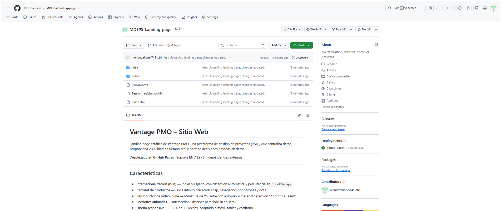
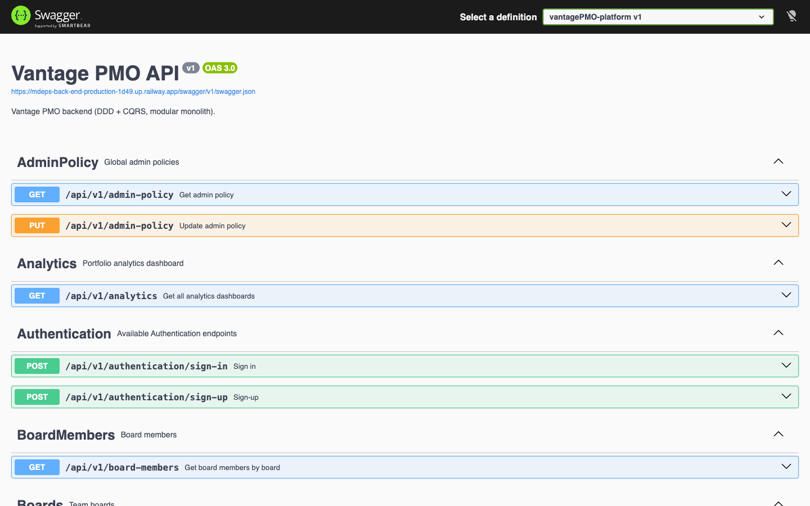
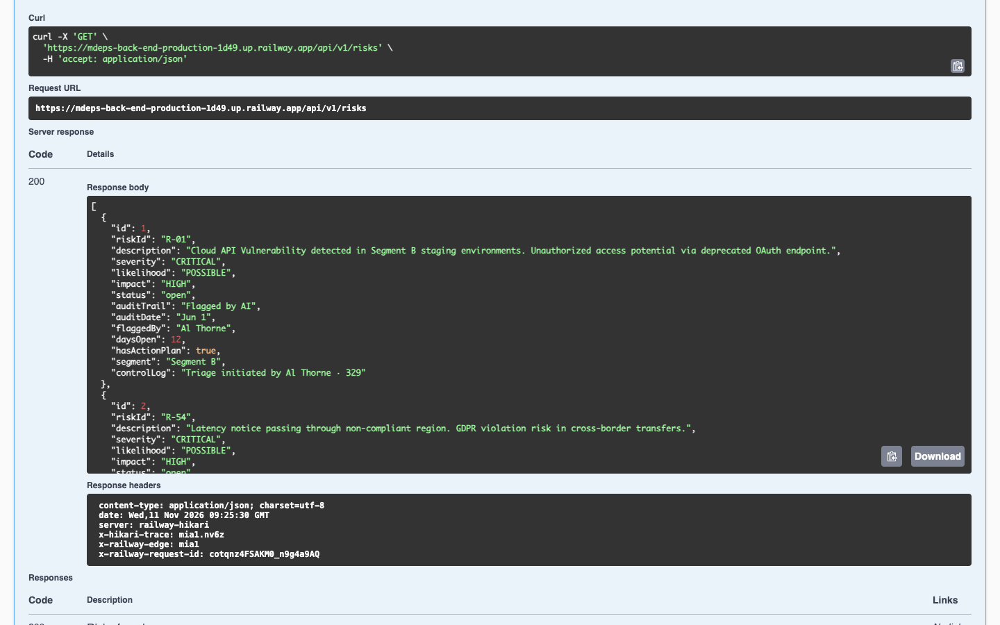
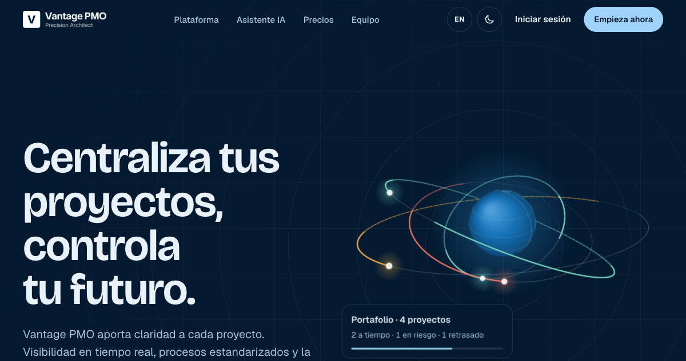
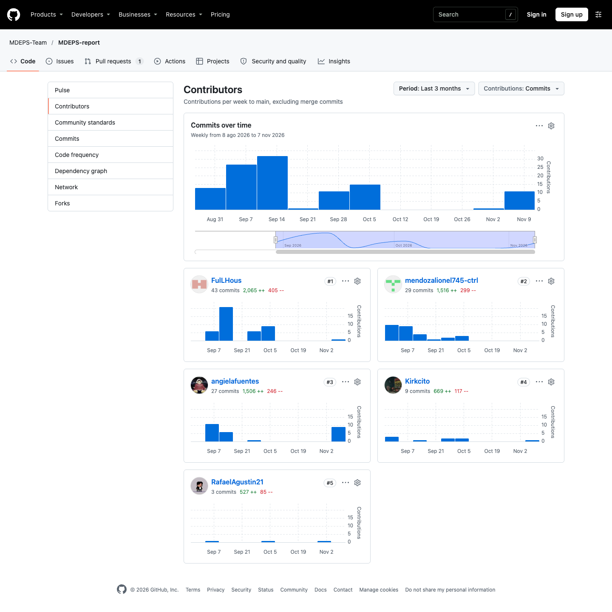

<div style="page-break-before: always;"></div>

<a id="capitulo-iv-product-implementation-validation"></a>
# Capítulo IV: Product Implementation & Validation

## 4.1. Software Configuration Management
<a id="5-1-software-configuration-management"></a>

### 4.1.1. Software Development Environment Configuration
<a id="5-1-1-software-development-environment-configuration"></a>

A continuación, se listan las herramientas y estándares adoptados por el equipo para el desarrollo colaborativo del sistema:

| Actividad               | Herramienta / Guía | Propósito                                                                    | Tipo de acceso / Ruta     |
| ----------------------- | --------------------------------------------------------------------------------------------------------------------------------------------------------------------------------- | ----------------------------------------------------------------------------- | ------------------------------------------------------------------------------------------------------------------------------------------------------------------------------------------------------------------- |
| Project Management      | Trello Software   | Seguimiento de backlog, tareas y sprints.                                     | SaaS –[https://trello.com/](https://trello.com/software/jira)          |
| Requirements Management | Gherkin Conventions   | Escritura legible de requisitos con formato Given/When/Then.                  | [https://cucumber.io/docs/gherkin/](https://cucumber.io/docs/gherkin/)          |
| Product UX/UI Design    | Figma   | Prototipos y diseño responsive.                                              | SaaS –[https://figma.com](https://figma.com)     |
| Landing Page             | HTML, CSS, JavaScript, Vue     | Construcción de la interfaz web.                                             | [https://vuejs.org/guide/introduction.html](https://vuejs.org/guide/introduction.html)       |
| User Personas, Empathy Journey Mapping, Impact Mapping   | UXPressia                | Es una herramienta en línea para el mapeo de la trayectoria del cliente que crea mapas de impacto y personas.    | [https://uxpressia.com/](https://uxpressia.com/)        |
| Class Diagram and Database Diagram  | LucidChart | Organización y modelado de las tablas y entidades del proyecto.         | [https://www.lucidchart.com/](https://www.lucidchart.com/)                                                                            |
| Code Standards          | Google HTML/CSS Style Guide, Vue Style Guide, MDN Guidelines, W3C JavaScript Style Guide, Google JavaScript Style Guide, C# Coding Conventions, Microsoft ASP.NET Core Guidelines | Aplicación de buenas prácticas de desarrollo en frontend y backend.         | [https://developer.mozilla.org/](https://developer.mozilla.org/) / [https://learn.microsoft.com/en-us/dotnet/csharp/fundamentals/coding-style](https://learn.microsoft.com/en-us/dotnet/csharp/fundamentals/coding-style) |
| Version Control         | Git + GitHub     | Control de versiones y trabajo colaborativo.                                  | SaaS –[https://github.com](https://github.com)  |
| Software Deployment     | Github pages   | Despliegue continuo de la aplicación para ambientes de prueba y validación. | SaaS –[https://railway.app](https://railway.app) / [https://render.com](https://render.com)  |
| Upgrade of Branches and Commits | Visual Studio Code | Optimización y documentación del proyecto asimismo el trabajo colaborativo. |[https://code.visualstudio.com/](https://code.visualstudio.com/)  |
| EventStorming | Miro | Herramienta colaborativa grupal que permitio diseñar mejor algunos puntos del trabajo. |[https://miro.com/es/](https://miro.com/es/)  |

<div style="text-align: left; max-width: 900px; margin: 0 auto;">

### 4.1.2. Source Code Management
<a id="5-1-2-source-code-management"></a>

Para la gestión del código del proyecto, el equipo adoptó una estrategia simplificada en lugar de implementar completamente el modelo Git Flow. Se trabajó principalmente sobre una rama principal (main), la cual contiene la versión estable y actual del sistema en desarrollo. 

Adicionalmente, se crearon algunas ramas específicas organizadas por capítulos del proyecto. Estas ramas permitieron desarrollar avances de manera más ordenada antes de integrarlos a la rama principal, sin llegar a una estructura compleja de múltiples ramas por funcionalidades o versiones. 

Todas las funcionalidades y mejoras fueron finalmente integradas en la rama main, asegurando que esta siempre represente el estado más actualizado del proyecto. Este enfoque, aunque más sencillo que Git Flow, resultó adecuado para el alcance del trabajo, ya que facilitó el control del progreso sin generar una sobrecarga en la gestión de ramas.

 Por otro lado, se utilizó GitHub como repositorio central del proyecto, aprovechando también herramientas como GitHub Pages para la visualización del Landing Page. Esto permitió desplegar rápidamente los avances en formato web y contar con una versión accesible del sistema de manera ágil y eficiente.

---

URL de los Repositorios:
Organización: https://github.com/MDEPS-Team
Reporte: https://github.com/MDEPS-Team/MDEPS-Landing-page
Landing Page: https://github.com/MDEPS-Team/MDEPS-Landing-page
Backend: https://github.com/MDEPS-Team/MDEPS-Back-End


### Versionado Semántico

Se aplicará el esquema de **Semantic Versioning 2.0.0**, con el siguiente formato:

- **MAJOR**: Incompatibilidades en la API.
- **MINOR**: Nuevas funcionalidades sin romper compatibilidad.
- **PATCH**: Correcciones de errores menores y ajustes sin afectar funcionalidades.

_Ejemplo de versión:_ `v1.3.4`

### Convenciones de Commits

Se adoptará el estándar de **Conventional Commits** para la redacción de los mensajes de commit, lo cual permitirá estructurar mejor los cambios realizados. Este enfoque facilita la automatización de procesos como la integración continua y la generación de historiales de cambios (changelogs).

**Ejemplos:**

- `feat: add project creation form`
- `fix: resolve error in task assignment module`
- `docs: update user stories and diagrams`
- `chore: update dependencies`
### 4.1.3. Source Code Style Guide & Conventions
<a id="5-1-3-source-code-style-guide-conventions"></a>

El código desarrollado por los miembros del equipo esté completamente redactado en inglés.

## **HTML**

* **Use Lowercase Element Names**: Se recomienda utilizar minúsculas para todos los elementos HTML.
```html
<section class="hero">
<h1>Centralize your projects</h1>
</section>

**Close All HTML Elements**: Todos los elementos deben cerrarse correctamente para evitar errores de renderizado.
```html
<p>Centralize your projects, control your future.</p>

<a href="#Contact">Solicitar demo</a>
```

**Use Lowercase Attribute Names**: Los atributos deben escribirse en minúsculas.

```html
<input type="email" placeholder="tu@correo.com" id="fe"/>
```
**Use Semantic HTML Elements**: Se deben utilizar etiquetas semánticas para mejorar la estructura y accesibilidad.

```html
<nav>...</nav>
<section id="funciones">...</section>
<footer>...</footer>
```

**Use Descriptive IDs and Classes**: Los nombres deben ser claros y representar su función.
```html
<section id="contact">
  <div class="contact-form">
```
## **CSS**

**Use Kebab-Case for Class Names**: Las clases deben escribirse en minúsculas separadas por guiones.
```css
.contact-form {
  display: flex;
}
```
**Use CSS Variables for Colors**: Se deben definir colores reutilizables en :root.
```css
:root {
  --blue: #1E40AF;
  --navy: #0F172A;
}
```
**Group Styles by Sections**: El código CSS debe organizarse por secciones del sitio.
```css
/* NAV */
nav { ... }
/* HERO */
.hero { ... }
/* FOOTER */
footer { ... }
```
**Use Consistent Spacing**: Se debe mantener consistencia en márgenes, padding y alineación.
```css
.section {
  padding: 6rem 2rem;
}
```
**Responsive Design with Media Queries**: Se deben usar breakpoints para adaptar la interfaz.
```css
@media (max-width: 600px) {
  .hero {
    padding: 4rem 1rem;
  }
}
```
## **JavaScript**

**Use CamelCase for Variables and Functions**: Las variables y funciones deben usar camelCase.
```js
function sendForm() {
  const userName = document.getElementById('fn').value;
}
```
**Keep Functions Simple and Clear**: Las funciones deben ser cortas y fáciles de entender.
```js
if (!n || !e) {
  alert('Por favor completa tu nombre y correo.');
  return;
}
```

**Use Meaningful Variable Names**: Los nombres deben representar su propósito.
```js
const navLinks = document.getElementById('navLinks');
const hamburger = document.getElementById('hamburger');
```
**Avoid Inline JavaScript**: Se recomienda mantener la lógica separada del HTML.
```js
< button onclick="sendForm()">Enviar</ button>
```
### 4.1.4. Software Deployment Configuration
<a id="5-1-4-software-deployment-configuration"></a>

Para la Landing Page desarrollada en HTML, CSS y JavaScript, la configuración del despliegue en GitHub Pages se define de la siguiente manera:

**Repositorio de Código Fuente**

Se debe crear un repositorio en GitHub y subir todos los archivos del proyecto (HTML, CSS, JS). Es obligatorio que el archivo index.html esté ubicado en la raíz del repositorio para poder realizar el despliegue correctamente.



**URL pública de la Landing Page:** [https://mdeps-team.github.io/MDEPS-Landing-page/](https://mdeps-team.github.io/MDEPS-Landing-page/)

**Despliegue del Backend (Web Service)**

Para el despliegue de la API REST y la base de datos, se utilizó la plataforma **Railway**. El proceso de configuración consistió en:
1. Provisión de un servicio de base de datos **MySQL** alojado en la nube.
2. Vinculación directa con el repositorio de GitHub (`MDEPS-Back-End`) utilizando el archivo `Dockerfile` ubicado en la raíz del proyecto para la compilación del entorno en .NET 10.
3. Configuración de variables de entorno, incluyendo la cadena de conexión a la base de datos (`ConnectionStrings__DefaultConnection`) y la habilitación de la documentación pública (`ASPNETCORE_ENVIRONMENT = Development`).

**URL pública de la documentación del backend (Swagger):** [https://mdeps-back-end-production-1d49.up.railway.app/swagger](https://mdeps-back-end-production-1d49.up.railway.app/swagger)

**Configuración de la aplicación móvil**

La aplicación Android del repositorio [MDEPS-Front-End](https://github.com/MDEPS-Team/MDEPS-Front-End) consume el backend desplegado mediante Retrofit. La URL base se define en la constante `BASE_URL` de `RetrofitClient.kt` (`https://mdeps-back-end-production-1d49.up.railway.app/`), de modo que cada compilación de la aplicación se conecta directamente con la API pública en Railway.

<a id="42-landing-page-mobile-application-implementation"></a>
## 4.2. Landing Page & Mobile Application Implementation

<a id="421-sprint-1"></a>
## 4.2.1. Sprint 1
<a id="4211-sprint-planning-1"></a>
##### 4.2.1.1. Sprint Planning 1

En esta sección, se presenta la planificación correspondiente al Sprint 1 de Vantage PMO.

| Sprint | Historias previstas en el Product Backlog | Story Points |
| :--- | :--- | :---: |
| Sprint 1 | US01, US02, US04, US05, US03, US16, US22, US17, US23, US24, TS01, TS04 | 42 |
| Sprint 2 | US07, US11, US12, US13, US09, SP01, SP02 | 34 |
| Sprint 3 | US08, US14, US06, US10, US19, US18, US15, US20, US21, TS02, TS03 | 43 |

| **Sprint #** | **Sprint 1** |
|--------------|--------------|
| **Sprint Planning Background** | |
| **Date** | [08/10/2026] |
| **Time** | [13:00] |
| **Location** | [zoom] |
| **Prepared By** | Fuentes Alvarez, Angiela Stephany |
| **Attendees** | Fuentes Alvarez, Angiela Stephany / Guillen Giraldo, Mike Dylan / Mendoza Machoa, Lionel Snayder / Pacheco Lavado, Rafael Agustin / Quiliano Motta, Kirk Douglas |
| **Sprint n-1 Review Summary** | No aplica |
| **Sprint n-1 Retrospective Summary** | No aplica |
| **Sprint Goal & User Stories** | |
| **Sprint 1** | El objetivo del Sprint 1 es transformar los requerimientos y hallazgos obtenidos durante las etapas de análisis en propuestas concretas de diseño y planificación para Vantage PMO. Durante este sprint, el equipo trabajará en la elaboración de los Wireframes y Mock-ups del Landing Page, el diseño UX/UI de la aplicación móvil, la definición de los flujos de usuario y el desarrollo del prototipo, buscando mantener coherencia con las necesidades identificadas en los segmentos objetivo y con los artefactos desarrollados previamente. |
| **Sprint 1 Velocity** | [24 Story Points] |
| **Sum of Story Points** | 42 Story Points |
##### 4.2.1.2. Aspect Leaders and Collaborators

En el marco del Sprint 1, se han priorizado las actividades relacionadas con la transformación de los requerimientos y hallazgos obtenidos durante las etapas de análisis en propuestas concretas de diseño y planificación para Vantage PMO. Los esfuerzos del equipo se orientan hacia el diseño de la Landing Page, el diseño UX/UI de la aplicación móvil, la elaboración de flujos de usuario y prototipos, así como las actividades relacionadas con la implementación y documentación de la solución.

A fin de garantizar una ejecución coordinada y una adecuada distribución de responsabilidades, se ha implementado la Matriz de Liderazgo y Colaboración (LACX). En esta herramienta se identifican los responsables principales (L) y los colaboradores (C) para cada aspecto del Sprint 1.

| **Team Member (Last Name, First Name)** | **GitHub Username** | **Landing Page** | **Mobile App UX/UI** | **User Flows & Prototyping** | **Implementation** | **Testing** | **Documentation** |
| ---------------------------------------- | ------------------- | ---------------- | -------------------- | ----------------------------- | ------------------ | ----------- | ---------------- |
| Fuentes Alvarez, Angiela Stephany | angielafuentes | L | C | C | C | C | L |
| Guillen Giraldo, Mike Dylan | FullHous | C | L | C | C | C | C |
| Mendoza Machoa, Lionel Snayder | mendozalionel745-ctrl | C | C | L | C | C | C |
| Pacheco Lavado, Rafael Agustin | RafaelAgustin21 | C | C | C | L | C | C |
| Quiliano Motta, Kirk Douglas | Kirkcito | C | C | C | C | L | C |

##### 4.2.1.3. Sprint Backlog 1

El Sprint Backlog 1 reúne las historias de usuario y actividades priorizadas por el equipo para el desarrollo del Sprint 1 de Vantage PMO. El trabajo está orientado a transformar los requerimientos y necesidades identificados durante las etapas anteriores en propuestas concretas de diseño, planificación y desarrollo de la solución.

Durante este sprint se consideran actividades relacionadas con el diseño de la Landing Page, el desarrollo de la experiencia UX/UI de la aplicación móvil, la elaboración de Wireflows y User Flows, la creación de Mock-ups, el desarrollo del prototipo y las funcionalidades correspondientes a las historias de usuario seleccionadas.

Las actividades de diseño UX/UI y prototipado de la aplicación se consideran tareas complementarias de apoyo al desarrollo del producto, por lo que no cuentan con un identificador de User Story específico en el Product Backlog.

**Screenshot del Board**


*Trello:* [Aplicaciones Móviles](https://trello.com/b/Gzag7ZlN/aplicaciones-moviles)

<table border="1" cellspacing="0" cellpadding="5">
  <tr>
    <th>Sprint #</th>
    <th colspan="7">Sprint 01</th>
  </tr>
  <tr>
    <th colspan="2">User Story</th>
    <th colspan="2">Work-item / Task</th>
    <th colspan="4"></th>
  </tr>
  <tr>
    <th>ID</th>
    <th>Title</th>
    <th>ID</th>
    <th>Title</th>
    <th>Description</th>
    <th>Estimation (hours)</th>
    <th>Assigned To</th>
    <th>Status</th>
  </tr>
  <tr>
    <td>US16</td>
    <td>Conocer la propuesta de valor de Vantage PMO</td>
    <td>T001</td>
    <td>Elaboración de Wireframes</td>
    <td>Diseñar la estructura visual y organización de contenidos del Landing Page considerando las necesidades identificadas durante el proceso de análisis.</td>
    <td>4 h</td>
    <td>Fuentes Alvarez, Angiela Stephany</td>
    <td>Listo</td>
  </tr>
  <tr>
    <td></td>
    <td></td>
    <td>T002</td>
    <td>Elaboración de Mock-ups</td>
    <td>Desarrollar los Mock-ups del Landing Page aplicando los lineamientos visuales y de experiencia de usuario definidos para Vantage PMO.</td>
    <td>5 h</td>
    <td>Guillen Giraldo, Mike Dylan</td>
    <td>Listo</td>
  </tr>
  <tr>
    <td>—</td>
    <td>Diseño UX/UI de la Aplicación Móvil</td>
    <td>T003</td>
    <td>Elaboración de Wireframes</td>
    <td>Diseñar los Wireframes de la aplicación móvil considerando los User Personas y las necesidades identificadas durante el proceso de Needfinding.</td>
    <td>5 h</td>
    <td>Mendoza Machoa, Lionel Snayder</td>
    <td>Listo</td>
  </tr>
  <tr>
    <td></td>
    <td></td>
    <td>T004</td>
    <td>Elaboración de Wireflow Diagrams</td>
    <td>Definir los flujos de interacción de la aplicación mediante Wireflows asociados a los principales objetivos de los usuarios.</td>
    <td>4 h</td>
    <td>Pacheco Lavado, Rafael Agustin</td>
    <td>Listo</td>
  </tr>
  <tr>
    <td></td>
    <td></td>
    <td>T005</td>
    <td>Elaboración de Mock-ups</td>
    <td>Desarrollar los Mock-ups de la aplicación móvil incorporando los principios de diseño, arquitectura de información y lineamientos visuales definidos.</td>
    <td>6 h</td>
    <td>Quiliano Motta, Kirk Douglas</td>
    <td>Listo</td>
  </tr>
  <tr>
    <td></td>
    <td></td>
    <td>T006</td>
    <td>Elaboración de User Flow Diagrams</td>
    <td>Representar los flujos de interacción esperados para los principales objetivos de los usuarios, incluyendo los caminos principales y alternativos.</td>
    <td>4 h</td>
    <td>Fuentes Alvarez, Angiela Stephany</td>
    <td>Listo</td>
  </tr>
  <tr>
    <td>—</td>
    <td>Prototipado de la Aplicación</td>
    <td>T007</td>
    <td>Desarrollo del prototipo</td>
    <td>Integrar los Mock-ups y flujos definidos para construir un prototipo navegable que permita validar la experiencia propuesta.</td>
    <td>8 h</td>
    <td>Mendoza Machoa, Lionel Snayder</td>
    <td>Listo</td>
  </tr>
  <tr>
    <td>US01</td>
    <td>Registrar un nuevo proyecto</td>
    <td>T008</td>
    <td>Diseño del formulario de registro</td>
    <td>Definir los campos y elementos de interfaz necesarios para registrar un nuevo proyecto.</td>
    <td>3 h</td>
    <td>Quiliano Motta, Kirk Douglas</td>
    <td>Listo</td>
  </tr>
  <tr>
    <td></td>
    <td></td>
    <td>T009</td>
    <td>Desarrollo del registro de proyectos</td>
    <td>Implementar la funcionalidad de registro de proyectos y las validaciones correspondientes.</td>
    <td>5 h</td>
    <td>Guillen Giraldo, Mike Dylan</td>
    <td>Listo</td>
  </tr>
  <tr>
    <td>US02</td>
    <td>Definir fases e hitos del proyecto</td>
    <td>T010</td>
    <td>Diseño de fases e hitos</td>
    <td>Definir la estructura para organizar las fases y los hitos asociados a cada proyecto.</td>
    <td>3 h</td>
    <td>Pacheco Lavado, Rafael Agustin</td>
    <td>Listo</td>
  </tr>
  <tr>
    <td></td>
    <td></td>
    <td>T011</td>
    <td>Gestión de fases e hitos</td>
    <td>Implementar las operaciones necesarias para registrar y administrar las fases e hitos de un proyecto.</td>
    <td>5 h</td>
    <td>Fuentes Alvarez, Angiela Stephany</td>
    <td>Listo</td>
  </tr>
  <tr>
    <td>US03</td>
    <td>Consultar el estado de múltiples proyectos</td>
    <td>T012</td>
    <td>Diseño de vista del portafolio</td>
    <td>Diseñar una vista que permita visualizar información general y estados de los proyectos registrados.</td>
    <td>3 h</td>
    <td>Guillen Giraldo, Mike Dylan</td>
    <td>Listo</td>
  </tr>
  <tr>
    <td></td>
    <td></td>
    <td>T013</td>
    <td>Consulta de proyectos</td>
    <td>Implementar la consulta y presentación del estado de múltiples proyectos del portafolio.</td>
    <td>5 h</td>
    <td>Quiliano Motta, Kirk Douglas</td>
    <td>Listo</td>
  </tr>
  <tr>
    <td>US04</td>
    <td>Asignar tareas a responsables</td>
    <td>T014</td>
    <td>Diseño de asignación de tareas</td>
    <td>Definir los elementos necesarios para seleccionar tareas y asociarlas con sus responsables.</td>
    <td>2 h</td>
    <td>Mendoza Machoa, Lionel Snayder</td>
    <td>Listo</td>
  </tr>
  <tr>
    <td></td>
    <td></td>
    <td>T015</td>
    <td>Implementación de asignaciones</td>
    <td>Implementar la funcionalidad para asignar tareas a los integrantes responsables del proyecto.</td>
    <td>4 h</td>
    <td>Pacheco Lavado, Rafael Agustin</td>
    <td>Listo</td>
  </tr>
  <tr>
    <td>US05</td>
    <td>Actualizar el estado de una tarea</td>
    <td>T016</td>
    <td>Definición de estados de tareas</td>
    <td>Definir los estados y transiciones que podrá presentar una tarea durante su ciclo de trabajo.</td>
    <td>2 h</td>
    <td>Fuentes Alvarez, Angiela Stephany</td>
    <td>Listo</td>
  </tr>
  <tr>
    <td></td>
    <td></td>
    <td>T017</td>
    <td>Actualización del estado de tareas</td>
    <td>Implementar la funcionalidad para actualizar y consultar el estado de las tareas.</td>
    <td>4 h</td>
    <td>Guillen Giraldo, Mike Dylan</td>
    <td>Listo</td>
  </tr>
  <tr>
    <td>US16</td>
    <td>Conocer la propuesta de valor de Vantage PMO</td>
    <td>T018</td>
    <td>Organización de la propuesta de valor</td>
    <td>Organizar los contenidos que comuniquen los beneficios y principales características de Vantage PMO.</td>
    <td>2 h</td>
    <td>Mendoza Machoa, Lionel Snayder</td>
    <td>Listo</td>
  </tr>
  <tr>
    <td></td>
    <td></td>
    <td>T019</td>
    <td>Integración de contenidos en Landing Page</td>
    <td>Incorporar la propuesta de valor y sus contenidos en la estructura de la Landing Page.</td>
    <td>3 h</td>
    <td>Pacheco Lavado, Rafael Agustin</td>
    <td>Listo</td>
  </tr>
  <tr>
    <td>US17</td>
    <td>Consultar medios de contacto del producto</td>
    <td>T020</td>
    <td>Diseño de sección de contacto</td>
    <td>Definir la estructura visual de la sección destinada a presentar los medios de contacto del producto.</td>
    <td>2 h</td>
    <td>Quiliano Motta, Kirk Douglas</td>
    <td>Listo</td>
  </tr>
  <tr>
    <td></td>
    <td></td>
    <td>T021</td>
    <td>Integración de medios de contacto</td>
    <td>Incorporar los medios de contacto disponibles en la Landing Page de Vantage PMO.</td>
    <td>3 h</td>
    <td>Fuentes Alvarez, Angiela Stephany</td>
    <td>Listo</td>
  </tr>
</table>
  
### 4.2.1.4. Development Evidence for Sprint Review

Durante el Sprint 1 se realizaron avances en la implementación de los productos que conforman Vantage PMO. Como parte del desarrollo, se avanzó en la construcción de los servicios del backend, incorporando la estructura necesaria para gestionar las principales capacidades del dominio mediante servicios RESTful.

El código fuente se mantiene en repositorios de GitHub, utilizando control de versiones para registrar los cambios realizados durante la implementación. En el backend se incorporaron componentes correspondientes a las capas de dominio, aplicación, infraestructura e interfaces REST, permitiendo establecer la base para las funcionalidades definidas para el Sprint 1.

A continuación, se presentan los commits asociados a los avances de implementación realizados durante el Sprint.

| Repository | Branch | Commit Id | Commit Message | Commit Message Body | Commited on (Date) |
| :--- | :--- | :--- | :--- | :--- | :--- |
| [MDEPS-Team/MDEPS-Back-End](https://github.com/MDEPS-Team/MDEPS-Back-End) | main | 062e857 | feat: backend migration | — | 2026-10-04 |

El commit presentado corresponde a la incorporación de la implementación inicial del backend de Vantage PMO, incluyendo la estructura de los diferentes módulos del dominio y los servicios REST necesarios para exponer las funcionalidades del sistema.

### 4.2.1.5. Testing Suite Evidence for Sprint Review

Durante el Sprint 1 se implementó una suite de pruebas automatizadas para validar parte de las funcionalidades del backend de Vantage PMO. Las pruebas fueron desarrolladas utilizando **xUnit** sobre **.NET 10**, incorporando pruebas unitarias, una prueba de integración y una prueba de aceptación bajo el enfoque BDD.

Las pruebas realizadas se encuentran relacionadas principalmente con la **US11 - Consultar indicadores de desempeño**, debido a que validan componentes pertenecientes al bounded context de Analytics, encargado de gestionar y proporcionar información relacionada con los indicadores de desempeño del portafolio.

La suite desarrollada permitió verificar tanto el comportamiento de objetos individuales del dominio como la interacción entre componentes de persistencia y la correcta satisfacción de un escenario de aceptación definido mediante Gherkin.

#### Unit Tests

Para las pruebas unitarias se seleccionaron objetos de valor pertenecientes al módulo Analytics. El objetivo fue comprobar que los objetos mantengan correctamente la información proporcionada durante su creación.

| Test ID | Test Type | Related User Story | Class | Test | Description |
| :--- | :--- | :--- | :--- | :--- | :--- |
| UT01 | Unit Test | US11 | `SummaryKpis` | `Constructor_ShouldAssignProvidedValues` | Verifica que los valores correspondientes a fondos disponibles, índice de velocidad, exposición al riesgo y planes de mitigación sean asignados correctamente al crear un objeto `SummaryKpis`. |
| UT02 | Unit Test | US11 | `PortfolioRoi` | `Constructor_ShouldAssignProvidedValues` | Verifica que el porcentaje de ROI, nivel de eficiencia, valor objetivo y valor proyectado sean almacenados correctamente en un objeto `PortfolioRoi`. |

Estas pruebas permiten validar de manera aislada los objetos utilizados para representar los principales indicadores de desempeño mostrados por el módulo Analytics.

#### Integration Tests

Para validar la interacción entre la capa de persistencia y el dominio se implementó una prueba de integración utilizando **Entity Framework Core InMemory**.

| Test ID | Test Type | Related User Story | Component | Test | Description |
| :--- | :--- | :--- | :--- | :--- | :--- |
| IT01 | Integration Test | US11 | `AnalyticsDashboardRepository` | `AddAndList_ShouldPersistAndReturnAnalyticsDashboard` | Verifica que un objeto `AnalyticsDashboard` pueda almacenarse mediante el repositorio y posteriormente recuperarse correctamente, conservando sus indicadores y datos asociados. |

La prueba utiliza una base de datos en memoria para verificar la integración entre `AppDbContext`, Entity Framework Core y `AnalyticsDashboardRepository`, evitando modificar la base de datos utilizada por la aplicación durante el desarrollo.

#### Acceptance Tests

Para validar el comportamiento esperado desde la perspectiva del usuario se implementó un Acceptance Test bajo el enfoque **Behavior-Driven Development (BDD)**.

El escenario se relaciona con la **US11 - Consultar indicadores de desempeño**, donde el Project Manager debe poder consultar los indicadores correspondientes al desempeño del portafolio.

El escenario fue definido mediante un archivo `.feature` utilizando Gherkin:

```gherkin
Feature: Analytics Dashboard

  As a Project Manager
  I want to consult portfolio performance indicators
  So that I can identify the current state and performance of the projects

  Scenario: Consult portfolio performance indicators successfully
    Given that analytics information exists for the portfolio
    When the Project Manager requests the analytics dashboard
    Then the system returns the portfolio performance indicators
```

Los Steps correspondientes fueron implementados en la clase `AnalyticsDashboardSteps`. En el paso `Given` se prepara información de Analytics utilizando una base de datos en memoria; en el paso `When` se consulta la información mediante `AnalyticsDashboardRepository`; finalmente, en el paso `Then` se verifica que el sistema retorne correctamente los indicadores de desempeño esperados.

| Test ID | Test Type | Related User Story | Feature | Scenario |
| :--- | :--- | :--- | :--- | :--- |
| AT01 | Acceptance Test - BDD | US11 | Analytics Dashboard | Consult portfolio performance indicators successfully |

#### Testing Execution Evidence

La ejecución de la suite de pruebas fue realizada mediante el Test Explorer de Visual Studio. Como resultado se ejecutaron cuatro pruebas automatizadas, obteniendo los siguientes resultados:

| Test Type | Tests Executed | Passed | Failed |
| :--- | :---: | :---: | :---: |
| Unit Tests | 2 | 2 | 0 |
| Integration Tests | 1 | 1 | 0 |
| Acceptance Tests | 1 | 1 | 0 |
| **Total** | **4** | **4** | **0** |

La ejecución confirmó que las cuatro pruebas implementadas finalizaron correctamente, sin presentar errores ni pruebas omitidas.


*Figura. Ejecución de la suite de pruebas del backend de Vantage PMO en Visual Studio, mostrando cuatro pruebas superadas y cero errores.*

Asimismo, la siguiente evidencia muestra el escenario de aceptación definido mediante Gherkin para la consulta de indicadores de desempeño.


*Figura. Escenario de Acceptance Test en Gherkin correspondiente a la US11 - Consultar indicadores de desempeño.*

#### Testing Repository and Commits

Los archivos correspondientes a las pruebas automatizadas se encuentran almacenados dentro del repositorio del backend de Vantage PMO, en el proyecto `vantagePMO-platform.Tests`.

**Repository:** [MDEPS-Team/MDEPS-Back-End](https://github.com/MDEPS-Team/MDEPS-Back-End)

Los principales archivos incorporados para la suite de pruebas son:

- `vantagePMO-platform.Tests/SummaryKpisTests.cs`
- `vantagePMO-platform.Tests/PortfolioRoiTests.cs`
- `vantagePMO-platform.Tests/AnalyticsDashboardRepositoryIntegrationTests.cs`
- `vantagePMO-platform.Tests/Features/analytics-dashboard.feature`
- `vantagePMO-platform.Tests/Features/Steps/AnalyticsDashboardSteps.cs`
- `vantagePMO-platform.Tests/vantagePMO-platform.Tests.csproj`

A continuación, se presenta el commit relacionado con la implementación de las pruebas durante el Sprint 1.

| Repository | Branch | Commit Id | Commit Message | Commit Message Body | Commited on (Date) |
| :--- | :--- | :--- | :--- | :--- | :--- |
| MDEPS-Team/MDEPS-Back-End | feature/4.2.1.5-testing | ff70649 | test: add sprint 1 backend test suite | — | 2026-10-05 |

### 4.2.1.6. Execution Evidence for Sprint Review
<a id="5-2-1-5-execution-evidence-for-sprint-review"></a>

Durante el presente Sprint, se ha logrado la transición de una interfaz estática a un ecosistema interactivo y funcional, cumpliendo con el objetivo de establecer el núcleo de acceso y la propuesta de valor visual de Vantage PMO. Los hitos alcanzados se centran en la implementación de un sistema de seguridad robusto, la personalización dinámica de la identidad de marca y la optimización de la experiencia de usuario a través de múltiples dispositivos y lenguajes.

**Resumen de Logros:**

- Seguridad y Acceso: Se ha desplegado un módulo de autenticación completo que integra proveedores de identidad modernos, garantizando un flujo de inicio de sesión seguro, validado y alineado con normativas legales de privacidad.

- Interactividad y Demostración: Se implementó un motor de previsualización en tiempo real que permite a los potenciales clientes interactuar con la plataforma, personalizando elementos de branding y visualizando la capacidad del dashboard de portafolio sin fricciones técnicas.

- Accesibilidad y Alcance Global: Gracias a la implementación de internacionalización (i18n) y un diseño estrictamente responsivo, la plataforma es ahora capaz de ofrecer una navegación coherente y profesional tanto en entornos de escritorio como en dispositivos móviles, eliminando barreras de idioma y formato.

- Comunicación Persistente: Se estableció la infraestructura de notificaciones push, permitiendo una conexión directa con el usuario y mejorando los índices de retención mediante alertas del sistema optimizadas.

A continuación, se presentan las evidencias gráficas de las vistas implementadas y el recurso audiovisual que detalla el flujo de navegación alcanzado:

Video de Demostración y Navegación: https://upcedupe-my.sharepoint.com/:v:/g/personal/u202417433_upc_edu_pe/IQBngnzzXajyRpPAik2w-PdQAW6q0V01RTT5qhqPQLRNLcg?nav=eyJyZWZlcnJhbEluZm8iOnsicmVmZXJyYWxBcHAiOiJPbmVEcml2ZUZvckJ1c2luZXNzIiwicmVmZXJyYWxBcHBQbGF0Zm9ybSI6IldlYiIsInJlZmVycmFsTW9kZSI6InZpZXciLCJyZWZlcnJhbFZpZXciOiJNeUZpbGVzTGlua0NvcHkifX0&e=SXvFNG

Screenshots de la Implementación:


**Ejecución e Interactividad del Backend**

Además del entorno web, se logró desplegar exitosamente el backend de Vantage PMO basado en arquitectura DDD y CQRS. A través de la interfaz interactiva de Swagger, se demostró la ejecución real de los Endpoints de los distintos Bounded Contexts (Authentication, Projects, Analytics, etc.).

Durante la validación, se ejecutaron peticiones `POST` para la creación de entidades y peticiones `GET` para verificar su correcta persistencia en la base de datos MySQL alojada en Railway, confirmando que la API no retorna datos simulados, sino que procesa transacciones reales.


*Figura: Interfaz interactiva de Swagger documentando los Bounded Contexts del sistema.*


*Figura: Ejecución de un endpoint de la API y respuesta HTTP validando la persistencia en la base de datos.*

<a id="4217-services-documentation-evidence-for-sprint-review"></a>
### 4.2.1.7. Services Documentation Evidence for Sprint Review

Durante el Sprint 1 se documentaron con OpenAPI los Web Services del backend de Vantage PMO. La documentación se genera con Swagger (`AddSwaggerGen`, `UseSwagger` y `UseSwaggerUI` en `Program.cs`) a partir de los controladores incorporados en el commit `062e857` del repositorio [MDEPS-Team/MDEPS-Back-End](https://github.com/MDEPS-Team/MDEPS-Back-End). La especificación publicada (`Vantage PMO API`, versión `v1`, OpenAPI 3.0.4) reúne 66 operaciones agrupadas en 33 recursos: 40 `GET`, 12 `POST`, 9 `PUT`, 3 `PATCH` y 2 `DELETE`.

**Documentación desplegada:** [https://mdeps-back-end-production-1d49.up.railway.app/swagger](https://mdeps-back-end-production-1d49.up.railway.app/swagger)

**Especificación OpenAPI (JSON):** [https://mdeps-back-end-production-1d49.up.railway.app/swagger/v1/swagger.json](https://mdeps-back-end-production-1d49.up.railway.app/swagger/v1/swagger.json)

La siguiente tabla presenta los endpoints documentados, con el verbo HTTP, la sintaxis de llamada, los parámetros y las respuestas declaradas en la especificación. Todas las rutas se invocan sobre la URL base `https://mdeps-back-end-production-1d49.up.railway.app`.

| Endpoint | Acción | Verbo HTTP | Sintaxis de llamada | Parámetros | Respuesta |
| :--- | :--- | :---: | :--- | :--- | :--- |
| AdminPolicy | Get admin policy | GET | `/api/v1/admin-policy` | — | 200 OK |
| AdminPolicy | Update admin policy | PUT | `/api/v1/admin-policy` | Body `UpdateAdminPolicyResource` | 200 OK |
| Analytics | Get all analytics dashboards | GET | `/api/v1/analytics` | — | 200 Analytics dashboards found. (`AnalyticsDashboardResource[]`) |
| Authentication | Sign in | POST | `/api/v1/authentication/sign-in` | Body `SignInResource` | 200 The user was authenticated (`AuthenticatedUserResource`); 400 Invalid username or password |
| Authentication | Sign-up | POST | `/api/v1/authentication/sign-up` | Body `SignUpResource` | 200 The user and profile were created successfully; 400 The sign-up data is invalid; 409 The username or email is already taken |
| BoardMembers | Get board members by board | GET | `/api/v1/board-members` | `boardId` (consulta) | 200 OK |
| Boards | Get all boards | GET | `/api/v1/boards` | — | 200 OK |
| Branding | Get branding settings | GET | `/api/v1/branding` | — | 200 OK |
| Branding | Update branding settings | PUT | `/api/v1/branding` | Body `UpdateBrandingResource` | 200 OK |
| ChatInsights | Get AI insights for a chat | GET | `/api/v1/chat-insights` | `chatId` (consulta) | 200 Insights found. (`ChatInsightResource[]`) |
| ChatMessages | Get all chat messages | GET | `/api/v1/chat-messages` | — | 200 Messages found. (`ChatMessageResource[]`) |
| ChatMessages | Create a chat message | POST | `/api/v1/chat-messages` | Body `CreateChatMessageResource` | 201 Message created. (`ChatMessageResource`); 400 Invalid message data. |
| ChatPinnedAssets | Get pinned assets for a chat | GET | `/api/v1/chat-pinned-assets` | `chatId` (consulta) | 200 Pinned assets found. (`ChatPinnedAssetResource[]`) |
| Chats | Get all chats | GET | `/api/v1/chats` | — | 200 Chats found. (`ChatResource[]`) |
| Chats | Create a chat | POST | `/api/v1/chats` | Body `CreateChatResource` | 201 Chat created. (`ChatResource`); 400 Invalid chat data. |
| Chats | Partially update a chat | PATCH | `/api/v1/chats/{id}` | `id` (ruta), Body `PatchChatResource` | 200 Chat updated. (`ChatResource`); 404 Chat not found. |
| ChatUsers | Get all chat users | GET | `/api/v1/chat-users` | — | 200 Chat users found. (`ChatUserResource[]`) |
| CollaborationTasks | Get dashboard or collaboration tasks | GET | `/api/v1/tasks` | `boardId` (consulta), `scope` (consulta) | 200 OK |
| CollaborationTasks | Create a collaboration task | POST | `/api/v1/tasks` | Body `CreateCollaborationTaskResource` | 200 OK |
| CollaborationTasks | Update a collaboration task | PUT | `/api/v1/tasks/{id}` | `id` (ruta), Body `UpdateCollaborationTaskResource` | 200 OK |
| CollaborationTasks | Delete a collaboration task | DELETE | `/api/v1/tasks/{id}` | `id` (ruta) | 200 OK |
| ComplianceMetrics | Get compliance metrics | GET | `/api/v1/compliance-metrics` | — | 200 Compliance metrics found. (`ComplianceMetricsResource[]`) |
| Departments | Get all departments | GET | `/api/v1/departments` | — | 200 Departments found. (`DepartmentResource[]`) |
| Endorsements | Get endorsements by user id | GET | `/api/v1/endorsements` | `userId` (consulta) | 200 Endorsements found. |
| LoginAttempts | Get recent login attempts | GET | `/api/v1/login-attempts` | — | 200 OK |
| Meetings | Get all meetings | GET | `/api/v1/meetings` | — | 200 Meetings found. (`MeetingResource[]`) |
| Meetings | Create a meeting | POST | `/api/v1/meetings` | Body `CreateMeetingResource` | 201 Meeting created. (`MeetingResource`); 400 Invalid meeting data. |
| Meetings | Get meeting by id | GET | `/api/v1/meetings/{id}` | `id` (ruta) | 200 Meeting found. (`MeetingResource`); 404 Meeting not found. |
| Meetings | Convert a meeting agreement into a collaboration task | POST | `/api/v1/meetings/{meetingId}/agreements/{agreementId}/convert-to-task` | `meetingId` (ruta), `agreementId` (ruta) | 200 Agreement converted. (`ConvertAgreementResultResource`); 404 Meeting or agreement not found. |
| Meetings | Export meeting minutes | GET | `/api/v1/meetings/{id}/minutes/export` | `id` (ruta), `format` (consulta), `attendees` (consulta), `agenda` (consulta), `minutes` (consulta), `agreements` (consulta) | 200 Minutes exported.; 404 Meeting not found. |
| Profiles | Get a profile by id | GET | `/api/v1/profiles/{id}` | `id` (ruta) | 200 The profile was found. (`ProfileResource`); 404 The profile does not exist. |
| Profiles | Update a profile | PATCH | `/api/v1/profiles/{id}` | `id` (ruta), Body `UpdateProfileResource` | 200 The profile was updated. (`ProfileResource`); 400 The profile data is invalid.; 404 The profile does not exist.; 409 The email is already registered. |
| Profiles | Get a profile by email | GET | `/api/v1/profiles` | `email` (consulta) | 200 The profile was found. (`ProfileResource`); 400 The email query parameter is missing.; 404 The profile does not exist. |
| ProfileSkills | Get profile skills by user id | GET | `/api/v1/profile-skills` | `userId` (consulta) | 200 Skills found. |
| Projects | Get all projects | GET | `/api/v1/projects` | — | 200 Projects found. (`ProjectResource[]`) |
| Projects | Create a project | POST | `/api/v1/projects` | Body `CreateProjectResource` | 201 Project created. (`ProjectResource`); 400 Invalid project data. |
| Projects | Get a project by id | GET | `/api/v1/projects/{id}` | `id` (ruta) | 200 Project found. (`ProjectResource`); 404 Project not found. |
| Projects | Update a project | PUT | `/api/v1/projects/{id}` | `id` (ruta), Body `UpdateProjectResource` | 200 Project updated. (`ProjectResource`); 400 Invalid project data.; 404 Project not found. |
| Reports | Get all executive project reports | GET | `/api/v1/reports` | — | 200 Reports found. (`ReportResource[]`) |
| ResourcePlanning | Get all resource planning dashboards | GET | `/api/v1/resource-planning` | — | 200 Resource planning dashboards found. (`ResourcePlanningDashboardResource[]`) |
| RiskMatrix | Get risk matrices | GET | `/api/v1/risk-matrix` | — | 200 Risk matrices found. (`RiskMatrixResource[]`) |
| Risks | Get all risks | GET | `/api/v1/risks` | — | 200 Risks found. (`RiskResource[]`) |
| Schedule | Get all schedule items | GET | `/api/v1/schedule` | — | 200 Schedule items found. (`ScheduleItemResource[]`) |
| Stats | Get stats by user id or list all portfolio stats | GET | `/api/v1/stats` | `userId` (consulta) | 200 Stats found. |
| Subscription | Get subscription | GET | `/api/v1/subscription` | — | 200 OK |
| Subscription | Update subscription | PUT | `/api/v1/subscription` | Body `UpdateSubscriptionResource` | 200 OK |
| Subscription | Renew subscription | GET | `/api/v1/subscription/{id}/renew` | `id` (ruta) | 200 OK |
| SupportTickets | Get all support tickets | GET | `/api/v1/support-tickets` | — | 200 Support tickets found. (`SupportTicketResource[]`) |
| SupportTickets | Create a support ticket | POST | `/api/v1/support-tickets` | Body `CreateSupportTicketResource` | 201 Support ticket created. (`SupportTicketResource`); 400 Invalid support ticket data. |
| SupportTickets | Update a support ticket | PUT | `/api/v1/support-tickets/{id}` | `id` (ruta), Body `UpdateSupportTicketResource` | 200 Support ticket updated. (`SupportTicketResource`); 400 Invalid support ticket data.; 404 Support ticket not found. |
| SystemSettings | Get system settings | GET | `/api/v1/system-settings` | — | 200 OK |
| SystemSettings | Update system settings | PUT | `/api/v1/system-settings` | Body `UpdateSystemSettingsResource` | 200 OK |
| Users | Get profile by user id | GET | `/api/v1/users/{id}` | `id` (ruta) | 200 The profile was found. (`ProfileResource`); 404 The profile does not exist. |
| Users | Update profile or password by user id | PATCH | `/api/v1/users/{id}` | `id` (ruta), Body `FrontPatchUserResource` | 200 The profile was updated. (`ProfileResource`) |
| Users | Sign-in, find by email, or list users | GET | `/api/v1/users` | `email` (consulta), `username` (consulta), `password` (consulta) | 200 Resources were found. |
| Users | Register user (front-end contract) | POST | `/api/v1/users` | Body `FrontSignUpResource` | 201 User created. (`FrontSignInUserResource`) |
| UserSchedules | Operación de UserSchedules | POST | `/api/v1/user-schedules` | Body `CreateScheduleResource` | 200 OK (`ScheduleResource`) |
| UserSchedules | Operación de UserSchedules | GET | `/api/v1/user-schedules/{id}` | `id` (ruta) | 200 OK (`ScheduleResource`) |
| UserSchedules | Operación de UserSchedules | PUT | `/api/v1/user-schedules/{id}` | `id` (ruta), Body `UpdateScheduleResource` | 200 OK |
| UserSchedules | Operación de UserSchedules | DELETE | `/api/v1/user-schedules/{id}` | `id` (ruta) | 200 OK |
| UserSchedules | Operación de UserSchedules | GET | `/api/v1/user-schedules/user/{userId}` | `userId` (ruta) | 200 OK (`ScheduleResource[]`) |
| UserSchedules | Operación de UserSchedules | GET | `/api/v1/user-schedules/user/{userId}/range` | `userId` (ruta), `startDate` (consulta), `endDate` (consulta) | 200 OK (`ScheduleResource[]`) |
| UserSettings | Get user settings | GET | `/api/v1/user-settings` | — | 200 User settings found. (`UserSettingsResource`); 404 User settings not found. |
| UserSettings | Update user settings | PUT | `/api/v1/user-settings` | Body `UpdateUserSettingsResource` | 200 User settings updated. (`UserSettingsResource`); 404 User settings not found. |
| WorkspaceSelection | Get workspace selection by user id | GET | `/api/v1/workspace-selection` | `userId` (consulta) | 200 Workspace selection found. (`WorkspaceSelectionResource`); 404 Workspace selection not found. |
| WorkspaceSelection | Save workspace selection | POST | `/api/v1/workspace-selection` | Body `CreateWorkspaceSelectionResource` | 201 Workspace selection saved. (`WorkspaceSelectionResource`); 400 Invalid workspace selection data. |

La interacción con la documentación desplegada y un ejemplo de respuesta con datos de muestra se presentan en la sección 4.2.2.7.

| Repository | Branch | Commit Id | Commit Message | Commit Message Body | Commited on (Date) |
| :--- | :--- | :--- | :--- | :--- | :--- |
| [MDEPS-Team/MDEPS-Back-End](https://github.com/MDEPS-Team/MDEPS-Back-End) | main | 062e857 | feat: backend migration | — | 2026-10-03 |

<a id="4218-software-deployment-evidence-for-sprint-review"></a>
### 4.2.1.8. Software Deployment Evidence for Sprint Review

En el Sprint 1 se realizaron los primeros despliegues de dos productos de la solución:

- **Landing Page:** el repositorio [MDEPS-Team/MDEPS-Landing-page](https://github.com/MDEPS-Team/MDEPS-Landing-page) se publicó con GitHub Pages a partir de la rama `main`, con el archivo `index.html` en la raíz. Los archivos se subieron el 2026-10-05 (commits `7e53621`, `be5861e` y `f386787`). La captura muestra el repositorio con el despliegue `github-pages` activo. URL pública: [https://mdeps-team.github.io/MDEPS-Landing-page/](https://mdeps-team.github.io/MDEPS-Landing-page/).
- **Web Services:** el backend se desplegó en Railway siguiendo los pasos descritos en la sección 4.1.4: base de datos MySQL en la nube, compilación con el `Dockerfile` del repositorio `MDEPS-Back-End` y variables de entorno para la cadena de conexión y la documentación pública.


*Figura. Repositorio MDEPS-Landing-page con el despliegue github-pages activo.*

<a id="4219-team-collaboration-insights-during-sprint"></a>
### 4.2.1.9. Team Collaboration Insights during Sprint

Durante el Sprint 1 (hasta el 5 de octubre de 2026) los commits de implementación se distribuyeron entre los repositorios de la solución de la siguiente manera (sin contar merges):

| Repositorio | Fuentes Alvarez, Angiela Stephany | Guillen Giraldo, Mike Dylan | Mendoza Machoa, Lionel Snayder | Pacheco Lavado, Rafael Agustin | Quiliano Motta, Kirk Douglas |
| :--- | :---: | :---: | :---: | :---: | :---: |
| MDEPS-Back-End | 0 | 0 | 1 | 1 | 1 |
| MDEPS-Landing-page | 0 | 0 | 2 | 1 | 1 |
| MDEPS-Front-End | 0 | 0 | 0 | 0 | 1 |

Mendoza Machoa, Lionel Snayder incorporó la implementación inicial del backend (`062e857`) y la primera versión de la Landing Page (`7e53621`). Pacheco Lavado, Rafael Agustin añadió la suite de pruebas del backend (`ff70649`) y la limpieza del repositorio de la Landing Page (`e2a9e3f`). Quiliano Motta, Kirk Douglas creó los repositorios MDEPS-Back-End y MDEPS-Front-End (`Initial commit`), subió archivos de la Landing Page (`be5861e`) y resolvió el conflicto de merge de `index.html` (`f386787`). En este Sprint, Fuentes Alvarez, Angiela Stephany y Guillen Giraldo, Mike Dylan concentraron su aporte en el repositorio del informe (Sprint Planning, Sprint Backlog y Capítulo III), como se observa en el Project Report Collaboration Insights.


<a id="422-sprint-2"></a>
## 4.2.2. Sprint 2

<a id="4221-sprint-planning-2"></a>
##### 4.2.2.1. Sprint Planning 2

En esta sección se presenta la planificación correspondiente al Sprint 2 de Vantage PMO.

| Sprint | Historias previstas en el Product Backlog | Story Points |
| :--- | :--- | :---: |
| Sprint 1 | US01, US02, US04, US05, US03, US16, US22, US17, US23, US24, TS01, TS04 | 42 |
| Sprint 2 | US07, US11, US12, US13, US09, SP01, SP02 | 34 |
| Sprint 3 | US08, US14, US06, US10, US19, US18, US15, US20, US21, TS02, TS03 | 43 |

| **Sprint #** | **Sprint 2** |
| :--- | :--- |
| **Sprint Planning Background** | Continuación del desarrollo de las funcionalidades de gestión y seguimiento de Vantage PMO. |
| **Date** | [Fecha real del Sprint Planning] |
| **Time** | [Hora real] |
| **Location** | [Lugar o plataforma utilizada] |
| **Prepared By** | Fuentes Alvarez, Angiela Stephany |
| **Attendees** | Fuentes Alvarez, Angiela Stephany / Guillen Giraldo, Mike Dylan / Mendoza Machoa, Lionel Snayder / Pacheco Lavado, Rafael Agustin / Quiliano Motta, Kirk Douglas |
| **Sprint n-1 Review Summary** | En el Sprint 1 se publicó la Landing Page en GitHub Pages; se implementó el backend de Vantage PMO con 66 endpoints documentados con OpenAPI y desplegados en Railway sobre una base de datos MySQL; y se incorporó una suite de 4 pruebas automatizadas (2 unitarias, 1 de integración y 1 de aceptación BDD) cuya ejecución finalizó con las 4 pruebas superadas. |
| **Sprint n-1 Retrospective Summary** | [Resumen de la retrospectiva del Sprint 1] |
| **Sprint Goal & User Stories** | |
| **Sprint 2** | El objetivo del Sprint 2 es fortalecer las capacidades de gestión, seguimiento y análisis de Vantage PMO. Durante este sprint se trabajará en el registro y seguimiento de riesgos, la centralización de documentos, la consulta de indicadores de desempeño, la generación de reportes y la recepción de alertas sobre eventos relevantes. Estas funcionalidades buscan mejorar el control de los proyectos y facilitar la toma de decisiones mediante información organizada y oportuna. |
| **Sprint 2 Velocity** | [Por determinar] |
| **Sum of Story Points** | 34 Story Points |

<a id="4222-aspect-leaders-and-collaborators"></a>
##### 4.2.2.2. Aspect Leaders and Collaborators

En el Sprint 2 los principales aspectos trabajados fueron la aplicación nativa Android, la aplicación multiplataforma en Flutter, la integración de la aplicación móvil con los Web Services desplegados, la Landing Page, las pruebas automatizadas y la documentación del informe. La matriz LACX se elaboró a partir de la autoría de los commits registrados en cada repositorio durante el Sprint: el líder (L) es el integrante con más commits en el aspecto y los colaboradores (C) son quienes también registraron commits en él. Un guion (—) indica que no hay commits del integrante en ese aspecto.

| **Team Member (Last Name, First Name)** | **GitHub Username** | **Android App** | **Flutter App** | **Integración con Web Services** | **Landing Page** | **Testing** | **Documentation** |
| ---------------------------------------- | ------------------- | --------------- | --------------- | -------------------------------- | ---------------- | ----------- | ----------------- |
| Fuentes Alvarez, Angiela Stephany | angielafuentes | — | — | — | — | — | L |
| Guillen Giraldo, Mike Dylan | FullHous | C | L | — | L | L | C |
| Mendoza Machoa, Lionel Snayder | mendozalionel745-ctrl | L | C | L | — | — | — |
| Pacheco Lavado, Rafael Agustin | RafaelAgustin21 | — | — | — | — | — | C |
| Quiliano Motta, Kirk Douglas | Kirkcito | — | — | — | — | — | C |

<a id="4223-sprint-backlog-2"></a>
##### 4.2.2.3. Sprint Backlog 2

El Sprint Backlog 2 reúne las historias de usuario y actividades seleccionadas para el segundo sprint de Vantage PMO. Las tareas están orientadas al desarrollo de funcionalidades que permitan gestionar riesgos, centralizar documentos, consultar indicadores, generar reportes y recibir notificaciones relevantes.

Durante este sprint se consideran actividades de diseño, desarrollo y validación de las funcionalidades relacionadas con el control y seguimiento de proyectos, así como la organización y presentación de información para apoyar la toma de decisiones.

**Trello:** [Aplicaciones Móviles](https://trello.com/b/Gzag7ZlN/aplicaciones-moviles)

<table border="1" cellspacing="0" cellpadding="5">
  <tr>
    <th>Sprint #</th>
    <th colspan="7">Sprint 02</th>
  </tr>
  <tr>
    <th colspan="2">User Story</th>
    <th colspan="2">Work-item / Task</th>
    <th colspan="4"></th>
  </tr>
  <tr>
    <th>ID</th>
    <th>Title</th>
    <th>ID</th>
    <th>Title</th>
    <th>Description</th>
    <th>Estimation (hours)</th>
    <th>Assigned To</th>
    <th>Status</th>
  </tr>
  <tr>
    <td>US07</td>
    <td>Registrar y realizar seguimiento de riesgos</td>
    <td>T022</td>
    <td>Diseño del módulo de riesgos</td>
    <td>Definir la estructura y los campos necesarios para registrar riesgos asociados a los proyectos.</td>
    <td>4 h</td>
    <td>Fuentes Alvarez, Angiela Stephany</td>
    <td>Por confirmar</td>
  </tr>
  <tr>
    <td></td><td></td>
    <td>T023</td>
    <td>Implementación de gestión de riesgos</td>
    <td>Desarrollar las funcionalidades para registrar, consultar y actualizar los riesgos identificados en los proyectos.</td>
    <td>8 h</td>
    <td>Guillen Giraldo, Mike Dylan</td>
    <td>Por confirmar</td>
  </tr>
  <tr>
    <td>US09</td>
    <td>Centralizar documentos de los proyectos</td>
    <td>T024</td>
    <td>Diseño del repositorio documental</td>
    <td>Definir la estructura de organización y clasificación de los documentos asociados a cada proyecto.</td>
    <td>4 h</td>
    <td>Mendoza Machoa, Lionel Snayder</td>
    <td>Por confirmar</td>
  </tr>
  <tr>
    <td></td><td></td>
    <td>T025</td>
    <td>Implementación de gestión documental</td>
    <td>Desarrollar las operaciones necesarias para registrar, almacenar y consultar documentos de los proyectos.</td>
    <td>8 h</td>
    <td>Pacheco Lavado, Rafael Agustin</td>
    <td>Por confirmar</td>
  </tr>
  <tr>
    <td>US11</td>
    <td>Consultar indicadores de desempeño</td>
    <td>T026</td>
    <td>Diseño de indicadores de desempeño</td>
    <td>Definir los indicadores y elementos visuales necesarios para presentar información sobre el desempeño del portafolio.</td>
    <td>4 h</td>
    <td>Quiliano Motta, Kirk Douglas</td>
    <td>Por confirmar</td>
  </tr>
  <tr>
    <td></td><td></td>
    <td>T027</td>
    <td>Implementación de consulta de indicadores</td>
    <td>Desarrollar la consulta y presentación de indicadores de desempeño de los proyectos.</td>
    <td>8 h</td>
    <td>Fuentes Alvarez, Angiela Stephany</td>
    <td>Por confirmar</td>
  </tr>
  <tr>
    <td>US12</td>
    <td>Generar reportes de desempeño</td>
    <td>T028</td>
    <td>Diseño de estructura de reportes</td>
    <td>Definir la estructura y los datos que serán incluidos en los reportes de desempeño de los proyectos.</td>
    <td>4 h</td>
    <td>Guillen Giraldo, Mike Dylan</td>
    <td>Por confirmar</td>
  </tr>
  <tr>
    <td></td><td></td>
    <td>T029</td>
    <td>Desarrollo de generación de reportes</td>
    <td>Implementar la generación de reportes utilizando la información disponible de los indicadores y proyectos.</td>
    <td>10 h</td>
    <td>Mendoza Machoa, Lionel Snayder</td>
    <td>Por confirmar</td>
  </tr>
  <tr>
    <td>US13</td>
    <td>Recibir alertas sobre eventos relevantes</td>
    <td>T030</td>
    <td>Diseño de alertas y notificaciones</td>
    <td>Identificar los eventos relevantes y definir los criterios para generar alertas y notificaciones a los usuarios.</td>
    <td>4 h</td>
    <td>Pacheco Lavado, Rafael Agustin</td>
    <td>Por confirmar</td>
  </tr>
  <tr>
    <td></td><td></td>
    <td>T031</td>
    <td>Implementación de notificaciones</td>
    <td>Desarrollar la funcionalidad para generar y presentar alertas relacionadas con eventos relevantes de los proyectos.</td>
    <td>8 h</td>
    <td>Quiliano Motta, Kirk Douglas</td>
    <td>Por confirmar</td>
  </tr>
</table>


<a id="4224-development-evidence-for-sprint-review"></a>
### 4.2.2.4. Development Evidence for Sprint Review

Durante el Sprint 2 el avance de implementación se concentró en las aplicaciones móviles y en la Landing Page:

- **Aplicación nativa Android** ([MDEPS-Team/MDEPS-Front-End](https://github.com/MDEPS-Team/MDEPS-Front-End)), desarrollada en Kotlin con Jetpack Compose y organizada por bounded contexts (`iam`, `pto`, `gro`, `ass`, `pm`). Se implementaron el inicio de sesión con autenticación biométrica (`androidx.biometric`), el registro multipaso y la recuperación de contraseña, la persistencia local con Room y DataStore, el acceso a la galería para el avatar del perfil, la gestión de proyectos y tareas con tablero Kanban y Roadmap, la generación y exportación nativa de reportes en PDF mediante `FileProvider`, la matriz de riesgos y la línea de tiempo de hitos, los KPIs calculados a partir de los módulos de proyectos y gobernanza, y la selección de idioma por aplicación (i18n). Al cierre del Sprint, los flujos de Sign-In y Sign-Up se conectaron con el backend desplegado en Railway mediante Retrofit y tokens JWT.
- **Aplicación multiplataforma en Flutter** ([MDEPS-Team/MDEPS-flutter](https://github.com/MDEPS-Team/MDEPS-flutter)), organizada con la misma división por bounded contexts. Se construyeron los flujos de splash, login, registro y recuperación de contraseña; el dashboard de inicio, el hub de proyectos, el detalle de proyecto, el tablero Kanban y el Roadmap; el hub de gobernanza con matriz de riesgos y línea de tiempo de hitos; el dashboard de analítica con exportación de reportes; y el perfil con preferencias, cambio de idioma (EN/ES) y cierre de sesión. En este Sprint, la aplicación Flutter trabaja con repositorios en memoria y datos de demostración; todavía no consume los Web Services.
- **Landing Page** ([MDEPS-Team/MDEPS-Landing-page](https://github.com/MDEPS-Team/MDEPS-Landing-page)): rediseño de la página con una vista 3D del portafolio, tema claro y oscuro, mejoras de accesibilidad (foco visible, *skip link*, `prefers-reduced-motion`) e imágenes optimizadas en WebP, integrado en `main` el 2026-11-09.

El backend no registró commits durante el Sprint 2; los Web Services implementados en el Sprint 1 se mantuvieron desplegados y fueron consumidos por la aplicación Android (ver 4.2.2.7).

A continuación se presentan los commits de implementación del Sprint 2 (del 2026-10-06 al 2026-11-11, sin contar merges) en cada repositorio.

#### Aplicación Android (Kotlin)

| Repository | Branch | Commit Id | Commit Message | Commit Message Body | Commited on (Date) |
| :--- | :--- | :--- | :--- | :--- | :--- |
| [MDEPS-Team/MDEPS-Front-End](https://github.com/MDEPS-Team/MDEPS-Front-End) | develop | c3d46eb | First contribution to the Android project | — | 2026-10-09 |
| [MDEPS-Team/MDEPS-Front-End](https://github.com/MDEPS-Team/MDEPS-Front-End) | feature/iam | 6eb5773 | feat(iam): initialize DDD directory structure and core dependencies | — | 2026-11-03 |
| [MDEPS-Team/MDEPS-Front-End](https://github.com/MDEPS-Team/MDEPS-Front-End) | feature/iam | f3ec7d3 | feat(iam): implement domain models and DataStore local storage | — | 2026-11-03 |
| [MDEPS-Team/MDEPS-Front-End](https://github.com/MDEPS-Team/MDEPS-Front-End) | feature/iam | cd2432f | feat(iam): build LoginScreen UI with i18n and accessibility support | — | 2026-11-03 |
| [MDEPS-Team/MDEPS-Front-End](https://github.com/MDEPS-Team/MDEPS-Front-End) | feature/iam | 641e245 | feat(iam): integrate biometric authentication for autonomous learning requirement | — | 2026-11-03 |
| [MDEPS-Team/MDEPS-Front-End](https://github.com/MDEPS-Team/MDEPS-Front-End) | feature/iam | 2cc9ad1 | feat(iam): build ProfileScreen and implement device gallery access for avatar | — | 2026-11-03 |
| [MDEPS-Team/MDEPS-Front-End](https://github.com/MDEPS-Team/MDEPS-Front-End) | feature/iam | 4ac9f8f | feat(iam): implement ViewModels, RESTful API integration logic and restore navigation | — | 2026-11-04 |
| [MDEPS-Team/MDEPS-Front-End](https://github.com/MDEPS-Team/MDEPS-Front-End) | feature/pto | 00a8973 | feat(pto): initialize DDD directory structure and core dependencies for Room and CameraX | — | 2026-11-04 |
| [MDEPS-Team/MDEPS-Front-End](https://github.com/MDEPS-Team/MDEPS-Front-End) | feature/pto | e6511f6 | feat(pto): implement domain models and Room local database for offline persistence | — | 2026-11-04 |
| [MDEPS-Team/MDEPS-Front-End](https://github.com/MDEPS-Team/MDEPS-Front-End) | feature/pto | 6e1ef46 | feat(pto): build Projects and Tasks UI with strict i18n and a11y compliance | — | 2026-11-04 |
| [MDEPS-Team/MDEPS-Front-End](https://github.com/MDEPS-Team/MDEPS-Front-End) | feature/pto | bb976bd | feat(pto): implement native PDF generation and export via FileProvider for autonomous learning requirement | — | 2026-11-04 |
| [MDEPS-Team/MDEPS-Front-End](https://github.com/MDEPS-Team/MDEPS-Front-End) | feature/pto | 77bd8a6 | feat(pto): implement ViewModel, state management and navigation wiring for PTO module | — | 2026-11-04 |
| [MDEPS-Team/MDEPS-Front-End](https://github.com/MDEPS-Team/MDEPS-Front-End) | feature/gro | 1f3ce1d | feat(gro): initialize DDD structure and core domain models for Risks and Milestones | — | 2026-11-04 |
| [MDEPS-Team/MDEPS-Front-End](https://github.com/MDEPS-Team/MDEPS-Front-End) | feature/gro | 8a65627 | feat(gro): implement Room local database and offline-first repositories for risks and milestones | — | 2026-11-04 |
| [MDEPS-Team/MDEPS-Front-End](https://github.com/MDEPS-Team/MDEPS-Front-End) | feature/gro | 296b277 | feat(gro): build interactive Risk Matrix UI with i18n, a11y and swipe-to-resolve gestures | — | 2026-11-04 |
| [MDEPS-Team/MDEPS-Front-End](https://github.com/MDEPS-Team/MDEPS-Front-End) | feature/gro | df5a488 | feat(gro): build custom interactive Milestone Timeline UI with dynamic graphics, i18n and a11y | — | 2026-11-04 |
| [MDEPS-Team/MDEPS-Front-End](https://github.com/MDEPS-Team/MDEPS-Front-End) | feature/gro | 9d3de76 | feat(gro): implement GroViewModel, UDF state management and navigation for interactive B2B dashboards | — | 2026-11-06 |
| [MDEPS-Team/MDEPS-Front-End](https://github.com/MDEPS-Team/MDEPS-Front-End) | feature/core-integration | 25e6856 | feat(integration): wire real project data to Home and centralize cross-module navigation in ProjectDetailScreen | — | 2026-11-07 |
| [MDEPS-Team/MDEPS-Front-End](https://github.com/MDEPS-Team/MDEPS-Front-End) | feature/core-integration | eb3150b | feat(integration): persist profile avatar via DataStore and wire real metrics to Home dashboard | — | 2026-11-07 |
| [MDEPS-Team/MDEPS-Front-End](https://github.com/MDEPS-Team/MDEPS-Front-End) | feature/core-integration | a2595b0 | feat(ass): implement AnalyticsViewModel to calculate real cross-module KPIs from PTO and GRO data | — | 2026-11-07 |
| [MDEPS-Team/MDEPS-Front-End](https://github.com/MDEPS-Team/MDEPS-Front-End) | feature/core-integration | d0bd3cf | style(ui): inject fluid animations, material elevation and snackbar feedback for a premium B2B experience | — | 2026-11-07 |
| [MDEPS-Team/MDEPS-Front-End](https://github.com/MDEPS-Team/MDEPS-Front-End) | feature/core-integration | e483460 | style(ui): Interface improvements | — | 2026-11-07 |
| [MDEPS-Team/MDEPS-Front-End](https://github.com/MDEPS-Team/MDEPS-Front-End) | feature/core-integration | 97ff52e | feat(i18n): implement dynamic per-app language selection in ProfileScreen | — | 2026-11-07 |
| [MDEPS-Team/MDEPS-Front-End](https://github.com/MDEPS-Team/MDEPS-Front-End) | feature/home-project-improvements | eda5b0b | feat(ui): improve home and project screens | — | 2026-11-07 |
| [MDEPS-Team/MDEPS-Front-End](https://github.com/MDEPS-Team/MDEPS-Front-End) | develop | d5bb95a | chore: ignore Kotlin compiler cache and remove error logs from repo | — | 2026-11-07 |
| [MDEPS-Team/MDEPS-Front-End](https://github.com/MDEPS-Team/MDEPS-Front-End) | develop | fefbb98 | feat: add motion components and success animation. | — | 2026-11-08 |
| [MDEPS-Team/MDEPS-Front-End](https://github.com/MDEPS-Team/MDEPS-Front-End) | develop | 90b38e7 | feat: add roadmap screen and kanban shortcuts. | — | 2026-11-08 |
| [MDEPS-Team/MDEPS-Front-End](https://github.com/MDEPS-Team/MDEPS-Front-End) | develop | aa1f413 | feat: revamp home dashboard and implement Kanban board UI. | — | 2026-11-08 |
| [MDEPS-Team/MDEPS-Front-End](https://github.com/MDEPS-Team/MDEPS-Front-End) | develop | 3ed7978 | feat: add registration and recovery view models. | — | 2026-11-08 |
| [MDEPS-Team/MDEPS-Front-End](https://github.com/MDEPS-Team/MDEPS-Front-End) | develop | 3a18f9a | feat: expand auth contract for registration and reset. | — | 2026-11-08 |
| [MDEPS-Team/MDEPS-Front-End](https://github.com/MDEPS-Team/MDEPS-Front-End) | develop | eeb274d | feat: add mock registration and reset auth flows. | — | 2026-11-08 |
| [MDEPS-Team/MDEPS-Front-End](https://github.com/MDEPS-Team/MDEPS-Front-End) | develop | 3f0b42f | chore: set GRO snackbar duration to long. | — | 2026-11-08 |
| [MDEPS-Team/MDEPS-Front-End](https://github.com/MDEPS-Team/MDEPS-Front-End) | develop | 4eeebb8 | feat: add multi-step authentication flows and splash screen UI. | — | 2026-11-08 |
| [MDEPS-Team/MDEPS-Front-End](https://github.com/MDEPS-Team/MDEPS-Front-End) | develop | 3f64d2b | feat: add Kanban view model and milestone digest. | — | 2026-11-08 |
| [MDEPS-Team/MDEPS-Front-End](https://github.com/MDEPS-Team/MDEPS-Front-End) | develop | fc8115c | feat: add Kanban task fields and Room database migration. | — | 2026-11-08 |
| [MDEPS-Team/MDEPS-Front-End](https://github.com/MDEPS-Team/MDEPS-Front-End) | develop | 99e9cbc | feat: add authentication flow and Kanban/Roadmap navigation routes. | — | 2026-11-08 |
| [MDEPS-Team/MDEPS-Front-End](https://github.com/MDEPS-Team/MDEPS-Front-End) | develop | 931534e | chore: add IAM and portfolio resource strings. | — | 2026-11-08 |
| [MDEPS-Team/MDEPS-Front-End](https://github.com/MDEPS-Team/MDEPS-Front-End) | develop | 2fad523 | chore: make gradlew executable. | — | 2026-11-08 |
| [MDEPS-Team/MDEPS-Front-End](https://github.com/MDEPS-Team/MDEPS-Front-End) | develop | aed96eb | refactor: move profile code from IAM to PM package. | — | 2026-11-08 |
| [MDEPS-Team/MDEPS-Front-End](https://github.com/MDEPS-Team/MDEPS-Front-End) | develop | 27d0be0 | refactor: move profile preferences to PM domain repository. | — | 2026-11-08 |
| [MDEPS-Team/MDEPS-Front-End](https://github.com/MDEPS-Team/MDEPS-Front-End) | develop | 9883f1d | chore: update app branding icons and brand mark. | — | 2026-11-08 |
| [MDEPS-Team/MDEPS-Front-End](https://github.com/MDEPS-Team/MDEPS-Front-End) | develop | 59a2dbb | feat: add IntelliJ Markdown preview settings. | Configure the project to use the experimental Compose Markdown preview panel in IntelliJ-based IDEs. | 2026-11-09 |
| [MDEPS-Team/MDEPS-Front-End](https://github.com/MDEPS-Team/MDEPS-Front-End) | feature/android-network-iam | 09ffd31 | feat(android): connect Sign-In and Sign-Up flows with Railway backend and fix JWT token settings | — | 2026-11-10 |
| [MDEPS-Team/MDEPS-Front-End](https://github.com/MDEPS-Team/MDEPS-Front-End) | feature/Connection-backend-and-frontend | b14932e | Connection-backend-and-frontend | — | 2026-11-10 |

#### Aplicación multiplataforma (Flutter)

| Repository | Branch | Commit Id | Commit Message | Commit Message Body | Commited on (Date) |
| :--- | :--- | :--- | :--- | :--- | :--- |
| [MDEPS-Team/MDEPS-flutter](https://github.com/MDEPS-Team/MDEPS-flutter) | main | 1c28135 | chore: initialize flutter project base | — | 2026-11-08 |
| [MDEPS-Team/MDEPS-flutter](https://github.com/MDEPS-Team/MDEPS-flutter) | feature/flutter-core-arch | e29cc93 | feat(core): setup DDD folder structure and main bottom navigation | — | 2026-11-08 |
| [MDEPS-Team/MDEPS-flutter](https://github.com/MDEPS-Team/MDEPS-flutter) | feature/flutter-core-arch | 54f4bfe | feat(core): add governance tab to main navigation | — | 2026-11-08 |
| [MDEPS-Team/MDEPS-flutter](https://github.com/MDEPS-Team/MDEPS-flutter) | feature/flutter-iam-ui | c705d00 | feat(iam): build static ui for login and basic profile structure | — | 2026-11-08 |
| [MDEPS-Team/MDEPS-flutter](https://github.com/MDEPS-Team/MDEPS-flutter) | feature/flutter-pm-ui | a81a139 | feat(pm): implement modular static UI for profile management | — | 2026-11-08 |
| [MDEPS-Team/MDEPS-flutter](https://github.com/MDEPS-Team/MDEPS-flutter) | feature/flutter-figma-ui | 0a668ce | build: add flutter_localizations and intl dependencies | Required for Spanish/English Material localizations and locale-aware date and number formatting. | 2026-11-10 |
| [MDEPS-Team/MDEPS-flutter](https://github.com/MDEPS-Team/MDEPS-flutter) | feature/flutter-figma-ui | 62d9e49 | feat(core): add Vantage design tokens and light/dark themes | VxPalette theme extension with the neutrals from the PMO mockups, brand accents and a Material 3 theme for the default and Dark Studio modes. | 2026-11-10 |
| [MDEPS-Team/MDEPS-flutter](https://github.com/MDEPS-Team/MDEPS-flutter) | feature/flutter-figma-ui | eea62d8 | feat(core): add bilingual string catalog and lookup helpers | Generated EN/ES catalog mirroring the reference app resources, extra strings for Figma-only screens and context.tr/trPlural/trArray helpers. | 2026-11-10 |
| [MDEPS-Team/MDEPS-flutter](https://github.com/MDEPS-Team/MDEPS-flutter) | feature/flutter-figma-ui | 8e41329 | feat(core): add motion tokens and entrance animations | Shared easing curves and durations, press-scale feedback, staggered entrance and fade route honoring reduced-motion settings. | 2026-11-10 |
| [MDEPS-Team/MDEPS-flutter](https://github.com/MDEPS-Team/MDEPS-flutter) | feature/flutter-figma-ui | 538ac91 | feat(core): add shared card, pill and top bar widgets | VxCard, Pill, Avatar, Caption, VxProgress, IconBadge, Dot, ProfileButton, VxTopBar and snackbar helper used across bounded contexts. | 2026-11-10 |
| [MDEPS-Team/MDEPS-flutter](https://github.com/MDEPS-Team/MDEPS-flutter) | feature/flutter-figma-ui | 72e11c7 | feat(core): add buttons, choice chips and text fields | VxButton with loading state, VxChoiceChip, VxSegmented, VxTextField with password reveal and the shared input decoration. | 2026-11-10 |
| [MDEPS-Team/MDEPS-flutter](https://github.com/MDEPS-Team/MDEPS-flutter) | feature/flutter-figma-ui | 308efa9 | feat(core): add brand mark and animated success mark | Vector Vantage V logo and the ring-and-check celebration used on success screens. | 2026-11-10 |
| [MDEPS-Team/MDEPS-flutter](https://github.com/MDEPS-Team/MDEPS-flutter) | feature/flutter-figma-ui | 4883906 | feat(core): add derived controller base and UI message listener | ChangeNotifier base that recomputes state from repositories, one-shot UI messages and a snackbar listener with undo support. | 2026-11-10 |
| [MDEPS-Team/MDEPS-flutter](https://github.com/MDEPS-Team/MDEPS-flutter) | feature/flutter-figma-ui | 49b099d | feat(iam): add identity domain and in-memory auth repository | User, credentials, registration draft, password and email policies, plus a mock identity provider with simulated latency. | 2026-11-10 |
| [MDEPS-Team/MDEPS-flutter](https://github.com/MDEPS-Team/MDEPS-flutter) | feature/flutter-figma-ui | 58a6e13 | feat(iam): add session, registration and recovery controllers | Sign-in and biometric session handling, four-step registration validation and the email/code/new-password recovery flow with resend countdown. | 2026-11-10 |
| [MDEPS-Team/MDEPS-flutter](https://github.com/MDEPS-Team/MDEPS-flutter) | feature/flutter-figma-ui | a219c15 | feat(iam): add shared auth flow components | Auth header, animated stepper, password strength meter, step intro, tiles and underlined links. | 2026-11-10 |
| [MDEPS-Team/MDEPS-flutter](https://github.com/MDEPS-Team/MDEPS-flutter) | feature/flutter-figma-ui | 5e8de3c | feat(iam): add splash and login screens | Animated brand splash and the login with corporate email, biometric prompt and SSO shortcuts. | 2026-11-10 |
| [MDEPS-Team/MDEPS-flutter](https://github.com/MDEPS-Team/MDEPS-flutter) | feature/flutter-figma-ui | a955cb2 | feat(iam): add multi-step registration flow | Personal data, contact and access, professional profile, role selection and account-ready summary. | 2026-11-10 |
| [MDEPS-Team/MDEPS-flutter](https://github.com/MDEPS-Team/MDEPS-flutter) | feature/flutter-figma-ui | a40934a | feat(iam): add password recovery flow | Email request, six-digit OTP input with shake on error, new password checklist and secure success log. | 2026-11-10 |
| [MDEPS-Team/MDEPS-flutter](https://github.com/MDEPS-Team/MDEPS-flutter) | feature/flutter-figma-ui | 58d5aca | feat(pto): add project and task domain with seeded repository | Project, task, status and priority models, initiative metadata helpers and an in-memory repository seeded with a demo portfolio. | 2026-11-10 |
| [MDEPS-Team/MDEPS-flutter](https://github.com/MDEPS-Team/MDEPS-flutter) | feature/flutter-figma-ui | b74eb2a | feat(gro): add risk and milestone domain with seeded repositories | Risk severity/status, milestones, seed content keys and in-memory repositories aligned with the demo portfolio. | 2026-11-10 |
| [MDEPS-Team/MDEPS-flutter](https://github.com/MDEPS-Team/MDEPS-flutter) | feature/flutter-figma-ui | bd6e353 | feat(pto): add portfolio and kanban controllers | Portfolio dashboard, milestone digest, project provisioning and task actions, plus the filtered kanban board with task creation. | 2026-11-10 |
| [MDEPS-Team/MDEPS-flutter](https://github.com/MDEPS-Team/MDEPS-flutter) | feature/flutter-figma-ui | a47508d | feat(gro): add governance controllers and policy store | Project risk/milestone actions with undo and status sync, governance policies and the portfolio compliance hub with audit and optimization. | 2026-11-10 |
| [MDEPS-Team/MDEPS-flutter](https://github.com/MDEPS-Team/MDEPS-flutter) | feature/flutter-figma-ui | 4a6de8d | feat(ass): add analytics controller and report exporter | Period-scoped KPIs (efficiency, SPI/CPI, budget, health, capacity) aggregating PTO and GRO data, and the executive export builder. | 2026-11-10 |
| [MDEPS-Team/MDEPS-flutter](https://github.com/MDEPS-Team/MDEPS-flutter) | feature/flutter-figma-ui | d04b324 | feat(pm): add profile domain, repository and controller | Operational preferences, in-memory profile store and portfolio-derived profile metrics with explicit save. | 2026-11-10 |
| [MDEPS-Team/MDEPS-flutter](https://github.com/MDEPS-Team/MDEPS-flutter) | feature/flutter-figma-ui | e23699a | feat(core): add composition root, app settings and shell navigator | AppServices wires every bounded context, AppSettings holds language, theme and onboarding state, and ShellNavigator defines cross-context navigation. | 2026-11-10 |
| [MDEPS-Team/MDEPS-flutter](https://github.com/MDEPS-Team/MDEPS-flutter) | feature/flutter-figma-ui | 56c1506 | feat(gro): add GRO UI helpers and add-record dialogs | Severity colors and labels, localized seed titles, target date formatting and the register risk / schedule gate dialogs. | 2026-11-10 |
| [MDEPS-Team/MDEPS-flutter](https://github.com/MDEPS-Team/MDEPS-flutter) | feature/flutter-figma-ui | 355919e | feat(pto): add PTO UI helpers and kanban labels | Localized project, task and status labels, date formatting, kanban status/priority styling and priority badge. | 2026-11-10 |
| [MDEPS-Team/MDEPS-flutter](https://github.com/MDEPS-Team/MDEPS-flutter) | feature/flutter-figma-ui | f8efafc | feat(pto): add home dashboard | Greeting, quick actions, priority risk alert, count-up KPI tiles, projects in focus and governance agenda. | 2026-11-10 |
| [MDEPS-Team/MDEPS-flutter](https://github.com/MDEPS-Team/MDEPS-flutter) | feature/flutter-figma-ui | 6cd3d40 | feat(pto): add projects hub | Portfolio KPIs, search, status filters, project cards with contextual actions and delete confirmation. | 2026-11-10 |
| [MDEPS-Team/MDEPS-flutter](https://github.com/MDEPS-Team/MDEPS-flutter) | feature/flutter-figma-ui | 736e43c | feat(pto): add project detail with evidence capture and report | Project summary, attention chips, task list with simulated evidence camera, quick actions sheet and shareable report preview. | 2026-11-10 |
| [MDEPS-Team/MDEPS-flutter](https://github.com/MDEPS-Team/MDEPS-flutter) | feature/flutter-figma-ui | 109586f | feat(pto): add create initiative screen | Provisioning form with identification, timeline, governance status, compliance switches and risk domain classification. | 2026-11-10 |
| [MDEPS-Team/MDEPS-flutter](https://github.com/MDEPS-Team/MDEPS-flutter) | feature/flutter-figma-ui | 05fb3c6 | feat(pto): add interactive kanban board | Swipeable status columns and compact view, sprint header and burndown, move with undo, create-task sheet and success dialog. | 2026-11-10 |
| [MDEPS-Team/MDEPS-flutter](https://github.com/MDEPS-Team/MDEPS-flutter) | feature/flutter-figma-ui | 4f98684 | feat(pto): add strategic roadmap | Quarter filter, roadmap velocity, task workload bar and expandable milestone arc with critical blockers. | 2026-11-10 |
| [MDEPS-Team/MDEPS-flutter](https://github.com/MDEPS-Team/MDEPS-flutter) | feature/flutter-figma-ui | 873f2da | feat(gro): add governance hub, risk matrix and milestone timeline | Compliance hero, frameworks, bandwidth, optimization, budget and policy toggles, swipe-to-resolve risks and toggleable gate timeline. | 2026-11-10 |
| [MDEPS-Team/MDEPS-flutter](https://github.com/MDEPS-Team/MDEPS-flutter) | feature/flutter-figma-ui | 9dd42dd | feat(ass): add advanced analytics dashboard | Period chips, efficiency trend and health donut charts, KPI cards, budget and capacity breakdowns, risk drill-down and export sheet. | 2026-11-10 |
| [MDEPS-Team/MDEPS-flutter](https://github.com/MDEPS-Team/MDEPS-flutter) | feature/flutter-figma-ui | 9494789 | feat(pm): rebuild profile screen with account and preference sheets | Profile hero, KPIs, account and security, PMO preferences, Dark Studio, language switch, access tier, avatar picker and logout confirmation. | 2026-11-10 |
| [MDEPS-Team/MDEPS-flutter](https://github.com/MDEPS-Team/MDEPS-flutter) | feature/flutter-figma-ui | 2b9ed44 | feat(core): wire auth gate and tabbed app shell | Splash/login/register/recovery gate, five-tab shell with nested navigation for full-screen flows and first-run onboarding. Removes the placeholder screens an... | 2026-11-10 |
| [MDEPS-Team/MDEPS-flutter](https://github.com/MDEPS-Team/MDEPS-flutter) | feature/flutter-figma-ui | e89023b | test: cover auth, navigation, profile and layout overflow | Registration validation, five-tab tour, language switch, profile modals and logout, project hub to kanban, and phone-width overflow smoke tests in light and... | 2026-11-10 |

#### Landing Page

| Repository | Branch | Commit Id | Commit Message | Commit Message Body | Commited on (Date) |
| :--- | :--- | :--- | :--- | :--- | :--- |
| [MDEPS-Team/MDEPS-Landing-page](https://github.com/MDEPS-Team/MDEPS-Landing-page) | feat/landing-3d-redesign | a58b55f | feat: rediseño "Observatorio" de la landing con orrery 3D | - Hero con vista 3D del portafolio en canvas (sin librerías): órbitas = avance, luz = salud; arrastre, teclado, inclinación con scroll, chips y lectura. - Or... | 2026-11-05 |
| [MDEPS-Team/MDEPS-Landing-page](https://github.com/MDEPS-Team/MDEPS-Landing-page) | feat/landing-3d-redesign | 11cdae6 | chore: excluir artefactos locales de Playwright | — | 2026-11-05 |
| [MDEPS-Team/MDEPS-Landing-page](https://github.com/MDEPS-Team/MDEPS-Landing-page) | feat/landing-3d-redesign | 1079637 | chore: limpiar archivos de herramientas y ampliar README | - Elimina .idea, .impeccable, DESIGN.md y PRODUCT.md del repositorio. - README: añade tecnologías, sistema visual y flujo de trabajo. | 2026-11-05 |

<a id="4225-testing-suite-evidence-for-sprint-review"></a>
### 4.2.2.5. Testing Suite Evidence for Sprint Review

En el Sprint 2 se incorporó una suite de pruebas de widgets para la aplicación Flutter, desarrollada con `flutter_test` en el archivo `test/widget_test.dart` del repositorio [MDEPS-Team/MDEPS-flutter](https://github.com/MDEPS-Team/MDEPS-flutter). Las pruebas levantan la aplicación completa (`VantagePmoApp`) y recorren los flujos de autenticación, navegación, cambio de idioma, perfil y gestión de proyectos, verificando los textos esperados del catálogo de traducciones. En este Sprint no se añadieron pruebas nuevas al backend; su suite corresponde a la presentada en la sección 4.2.1.5.

| Test ID | Test Type | Related User Story | Test | Description |
| :--- | :--- | :--- | :--- | :--- |
| WT01 | Widget Test | US18 | `Muestra el splash y luego la pantalla de login` | Verifica que la aplicación muestre el splash con la versión y luego la pantalla de inicio de sesión. |
| WT02 | Widget Test | US19 | `El registro valida los campos obligatorios` | Verifica que el registro muestre los errores de campos obligatorios y de fecha de nacimiento al intentar avanzar sin datos. |
| WT03 | Widget Test | US03, US14 | `Login → onboarding → recorre las 5 pestañas` | Verifica el inicio de sesión, el onboarding y la navegación por las pestañas de inicio, proyectos, analítica, gobernanza y perfil. |
| WT04 | Widget Test | — (requisito de i18n) | `El perfil cambia el idioma de toda la app a inglés` | Verifica que al seleccionar inglés en el perfil la interfaz cambie de idioma. |
| WT05 | Widget Test | US05, US07 | `Recorre las pantallas secundarias sin desbordes (dark: false / true)` | Se ejecuta en tema claro y oscuro; abre Roadmap, riesgos, hitos, creación de proyecto, Kanban y la hoja de nueva tarea, y verifica que se muestren sin desbordes. |
| WT06 | Widget Test | US20, US21 | `Perfil: foto, editar cuenta y cerrar sesión con confirmación` | Verifica la actualización del avatar, la apertura de la edición de cuenta y el cierre de sesión con confirmación. |
| WT07 | Widget Test | US03, US05 | `Abre el detalle de un proyecto y el kanban desde Proyectos` | Verifica la navegación desde el hub de proyectos hacia el detalle de proyecto y el tablero Kanban. |

| Repository | Branch | Commit Id | Commit Message | Commit Message Body | Commited on (Date) |
| :--- | :--- | :--- | :--- | :--- | :--- |
| [MDEPS-Team/MDEPS-flutter](https://github.com/MDEPS-Team/MDEPS-flutter) | feature/flutter-figma-ui | e89023b | test: cover auth, navigation, profile and layout overflow | Registration validation, five-tab tour, language switch, profile modals and logout, project hub to kanban, and phone-width overflow smoke tests in light and dark themes. | 2026-11-10 |

<a id="4226-execution-evidence-for-sprint-review"></a>
### 4.2.2.6. Execution Evidence for Sprint Review

Al cierre del Sprint 2, Vantage PMO cuenta con dos aplicaciones móviles con las vistas core del producto: autenticación (login, registro y recuperación de contraseña), dashboard de inicio, hub y detalle de proyectos, tablero Kanban, Roadmap, matriz de riesgos e hitos, analítica de KPIs con exportación de reportes y perfil con preferencias e idioma. En la aplicación Android, el inicio de sesión y el registro ya se ejecutan contra el backend desplegado; además, la aplicación define servicios Retrofit para proyectos, tareas, agenda, riesgos, analítica, perfil y soporte (sección 4.2.2.7) y utiliza persistencia local con Room y DataStore. La Landing Page rediseñada se encuentra publicada en GitHub Pages.

<a id="4227-services-documentation-evidence-for-sprint-review"></a>
### 4.2.2.7. Services Documentation Evidence for Sprint Review

En el Sprint 2 no se agregaron endpoints nuevos: la documentación OpenAPI de los 66 endpoints implementados en el Sprint 1 (sección 4.2.1.7) se mantuvo publicada en Railway, y el avance consistió en que la aplicación Android consumiera esos servicios. La siguiente tabla presenta los 37 endpoints que la aplicación Android invoca desde sus servicios Retrofit (`IamApiService`, `PtoApiService`, `AgendaApiService`, `GroApiService`, `AssApiService`, `PmApiService` y `SupportApiService`), con su documentación según la especificación desplegada.

**Documentación desplegada:** [https://mdeps-back-end-production-1d49.up.railway.app/swagger](https://mdeps-back-end-production-1d49.up.railway.app/swagger)

**Repositorio de Web Services:** [MDEPS-Team/MDEPS-Back-End](https://github.com/MDEPS-Team/MDEPS-Back-End)

| Endpoint | Acción | Verbo HTTP | Sintaxis de llamada | Parámetros | Respuesta |
| :--- | :--- | :---: | :--- | :--- | :--- |
| Analytics | Get all analytics dashboards | GET | `/api/v1/analytics` | — | 200 Analytics dashboards found. (`AnalyticsDashboardResource[]`) |
| Authentication | Sign in | POST | `/api/v1/authentication/sign-in` | Body `SignInResource` | 200 The user was authenticated (`AuthenticatedUserResource`); 400 Invalid username or password |
| Authentication | Sign-up | POST | `/api/v1/authentication/sign-up` | Body `SignUpResource` | 200 The user and profile were created successfully; 400 The sign-up data is invalid; 409 The username or email is already taken |
| Boards | Get all boards | GET | `/api/v1/boards` | — | 200 OK |
| ChatMessages | Get all chat messages | GET | `/api/v1/chat-messages` | — | 200 Messages found. (`ChatMessageResource[]`) |
| ChatMessages | Create a chat message | POST | `/api/v1/chat-messages` | Body `CreateChatMessageResource` | 201 Message created. (`ChatMessageResource`); 400 Invalid message data. |
| Chats | Get all chats | GET | `/api/v1/chats` | — | 200 Chats found. (`ChatResource[]`) |
| Chats | Create a chat | POST | `/api/v1/chats` | Body `CreateChatResource` | 201 Chat created. (`ChatResource`); 400 Invalid chat data. |
| CollaborationTasks | Get dashboard or collaboration tasks | GET | `/api/v1/tasks` | `boardId` (consulta), `scope` (consulta) | 200 OK |
| CollaborationTasks | Create a collaboration task | POST | `/api/v1/tasks` | Body `CreateCollaborationTaskResource` | 200 OK |
| CollaborationTasks | Update a collaboration task | PUT | `/api/v1/tasks/{id}` | `id` (ruta), Body `UpdateCollaborationTaskResource` | 200 OK |
| CollaborationTasks | Delete a collaboration task | DELETE | `/api/v1/tasks/{id}` | `id` (ruta) | 200 OK |
| ComplianceMetrics | Get compliance metrics | GET | `/api/v1/compliance-metrics` | — | 200 Compliance metrics found. (`ComplianceMetricsResource[]`) |
| Meetings | Get all meetings | GET | `/api/v1/meetings` | — | 200 Meetings found. (`MeetingResource[]`) |
| Meetings | Create a meeting | POST | `/api/v1/meetings` | Body `CreateMeetingResource` | 201 Meeting created. (`MeetingResource`); 400 Invalid meeting data. |
| Profiles | Get a profile by id | GET | `/api/v1/profiles/{id}` | `id` (ruta) | 200 The profile was found. (`ProfileResource`); 404 The profile does not exist. |
| Profiles | Update a profile | PATCH | `/api/v1/profiles/{id}` | `id` (ruta), Body `UpdateProfileResource` | 200 The profile was updated. (`ProfileResource`); 400 The profile data is invalid.; 404 The profile does not exist.; 409 The email is already registered. |
| Profiles | Get a profile by email | GET | `/api/v1/profiles` | `email` (consulta) | 200 The profile was found. (`ProfileResource`); 400 The email query parameter is missing.; 404 The profile does not exist. |
| Projects | Get all projects | GET | `/api/v1/projects` | — | 200 Projects found. (`ProjectResource[]`) |
| Projects | Create a project | POST | `/api/v1/projects` | Body `CreateProjectResource` | 201 Project created. (`ProjectResource`); 400 Invalid project data. |
| Projects | Get a project by id | GET | `/api/v1/projects/{id}` | `id` (ruta) | 200 Project found. (`ProjectResource`); 404 Project not found. |
| Projects | Update a project | PUT | `/api/v1/projects/{id}` | `id` (ruta), Body `UpdateProjectResource` | 200 Project updated. (`ProjectResource`); 400 Invalid project data.; 404 Project not found. |
| Reports | Get all executive project reports | GET | `/api/v1/reports` | — | 200 Reports found. (`ReportResource[]`) |
| ResourcePlanning | Get all resource planning dashboards | GET | `/api/v1/resource-planning` | — | 200 Resource planning dashboards found. (`ResourcePlanningDashboardResource[]`) |
| RiskMatrix | Get risk matrices | GET | `/api/v1/risk-matrix` | — | 200 Risk matrices found. (`RiskMatrixResource[]`) |
| Risks | Get all risks | GET | `/api/v1/risks` | — | 200 Risks found. (`RiskResource[]`) |
| Stats | Get stats by user id or list all portfolio stats | GET | `/api/v1/stats` | `userId` (consulta) | 200 Stats found. |
| SupportTickets | Get all support tickets | GET | `/api/v1/support-tickets` | — | 200 Support tickets found. (`SupportTicketResource[]`) |
| SupportTickets | Create a support ticket | POST | `/api/v1/support-tickets` | Body `CreateSupportTicketResource` | 201 Support ticket created. (`SupportTicketResource`); 400 Invalid support ticket data. |
| SupportTickets | Update a support ticket | PUT | `/api/v1/support-tickets/{id}` | `id` (ruta), Body `UpdateSupportTicketResource` | 200 Support ticket updated. (`SupportTicketResource`); 400 Invalid support ticket data.; 404 Support ticket not found. |
| Users | Get profile by user id | GET | `/api/v1/users/{id}` | `id` (ruta) | 200 The profile was found. (`ProfileResource`); 404 The profile does not exist. |
| Users | Update profile or password by user id | PATCH | `/api/v1/users/{id}` | `id` (ruta), Body `FrontPatchUserResource` | 200 The profile was updated. (`ProfileResource`) |
| UserSchedules | Operación de UserSchedules | POST | `/api/v1/user-schedules` | Body `CreateScheduleResource` | 200 OK (`ScheduleResource`) |
| UserSchedules | Operación de UserSchedules | GET | `/api/v1/user-schedules/user/{userId}` | `userId` (ruta) | 200 OK (`ScheduleResource[]`) |
| UserSchedules | Operación de UserSchedules | GET | `/api/v1/user-schedules/user/{userId}/range` | `userId` (ruta), `startDate` (consulta), `endDate` (consulta) | 200 OK (`ScheduleResource[]`) |
| UserSettings | Get user settings | GET | `/api/v1/user-settings` | — | 200 User settings found. (`UserSettingsResource`); 404 User settings not found. |
| UserSettings | Update user settings | PUT | `/api/v1/user-settings` | Body `UpdateUserSettingsResource` | 200 User settings updated. (`UserSettingsResource`); 404 User settings not found. |

**Ejemplo de interacción con datos de muestra:** `GET /api/v1/risks` (US07 - Registrar y realizar seguimiento de riesgos), ejecutado desde la documentación desplegada el 2026-11-11, retorna `200 OK` con la lista de riesgos registrados. Cada elemento incluye su identificador, descripción, severidad, probabilidad, impacto, estado y segmento:

```json
{
  "id": 1,
  "riskId": "R-01",
  "description": "Cloud API Vulnerability detected in Segment B staging environments. Unauthorized access potential via deprecated OAuth endpoint.",
  "severity": "CRITICAL",
  "likelihood": "POSSIBLE",
  "impact": "HIGH",
  "status": "open",
  "daysOpen": 12,
  "hasActionPlan": true,
  "segment": "Segment B"
}
```



*Figura. Documentación OpenAPI de Vantage PMO API desplegada en Railway.*



*Figura. Ejecución de `GET /api/v1/risks` desde Swagger con respuesta 200 y datos de muestra.*

Los commits del Sprint 2 relacionados con el consumo de los servicios documentados son:

| Repository | Branch | Commit Id | Commit Message | Commit Message Body | Commited on (Date) |
| :--- | :--- | :--- | :--- | :--- | :--- |
| [MDEPS-Team/MDEPS-Front-End](https://github.com/MDEPS-Team/MDEPS-Front-End) | feature/iam | 4ac9f8f | feat(iam): implement ViewModels, RESTful API integration logic and restore navigation | — | 2026-11-04 |
| [MDEPS-Team/MDEPS-Front-End](https://github.com/MDEPS-Team/MDEPS-Front-End) | feature/android-network-iam | 09ffd31 | feat(android): connect Sign-In and Sign-Up flows with Railway backend and fix JWT token settings | — | 2026-11-10 |
| [MDEPS-Team/MDEPS-Front-End](https://github.com/MDEPS-Team/MDEPS-Front-End) | feature/Connection-backend-and-frontend | b14932e | Connection-backend-and-frontend | — | 2026-11-10 |

<a id="4228-software-deployment-evidence-for-sprint-review"></a>
### 4.2.2.8. Software Deployment Evidence for Sprint Review

En el Sprint 2 se realizaron las siguientes actividades de despliegue:

- **Landing Page:** el rediseño de la rama `feat/landing-3d-redesign` se integró en `develop` (Pull Request #2, 2026-11-06) y luego en `main` (Pull Request #3, 2026-11-09), con lo que GitHub Pages publicó la nueva versión en [https://mdeps-team.github.io/MDEPS-Landing-page/](https://mdeps-team.github.io/MDEPS-Landing-page/).
- **Web Services:** el backend continúa desplegado en Railway y su documentación es accesible públicamente en [https://mdeps-back-end-production-1d49.up.railway.app/swagger](https://mdeps-back-end-production-1d49.up.railway.app/swagger). El 2026-11-11 se comprobó que la documentación y los endpoints de consulta responden con código 200.
- **Aplicación Android:** se configuró la URL base del backend en Railway (`RetrofitClient.kt`) y se conectaron los flujos de Sign-In y Sign-Up, junto con el ajuste de la configuración del token JWT (commit `09ffd31`). La distribución de la aplicación mediante Firebase App Distribution corresponde a la entrega TB2.



*Figura. Landing Page de Vantage PMO publicada en GitHub Pages tras el rediseño del Sprint 2.*

<a id="4229-team-collaboration-insights-during-sprint"></a>
### 4.2.2.9. Team Collaboration Insights during Sprint

La siguiente tabla resume los commits registrados por cada integrante durante el Sprint 2 (del 2026-10-06 al 2026-11-11, sin contar merges):

| Repositorio | Fuentes Alvarez, Angiela Stephany | Guillen Giraldo, Mike Dylan | Mendoza Machoa, Lionel Snayder | Pacheco Lavado, Rafael Agustin | Quiliano Motta, Kirk Douglas |
| :--- | :---: | :---: | :---: | :---: | :---: |
| MDEPS-Front-End (Android) | 0 | 17 | 27 | 0 | 0 |
| MDEPS-flutter | 0 | 34 | 5 | 0 | 0 |
| MDEPS-Landing-page | 0 | 3 | 0 | 0 | 0 |
| MDEPS-Back-End | 0 | 0 | 0 | 0 | 0 |
| MDEPS-report | 9 | 9 | 0 | 1 | 2 |

La implementación del Sprint 2 se concentró en dos integrantes: Mendoza Machoa, Lionel Snayder lideró la aplicación Android y su integración con el backend, y Guillen Giraldo, Mike Dylan lideró la aplicación Flutter y el rediseño de la Landing Page, además de colaborar en la aplicación Android. Fuentes Alvarez, Angiela Stephany, Pacheco Lavado, Rafael Agustin y Quiliano Motta, Kirk Douglas aportaron en el informe (Product Backlog, planificación de sprints, diagramas de flujo y capturas). Para el Sprint 3, el equipo debe distribuir la implementación entre todos los integrantes, de modo que cada uno participe en los productos de software, como exige el proyecto.



*Figura. Contribuciones por integrante en el repositorio del informe (GitHub Insights).*

Como referencia acumulada, la siguiente tabla resume los commits registrados por cada integrante desde el inicio del proyecto (primer commit del 2026-09-02) hasta el 2026-11-11, considerando todas las ramas y sin contar merges:

| Repositorio | Fuentes Alvarez, Angiela Stephany | Guillen Giraldo, Mike Dylan | Mendoza Machoa, Lionel Snayder | Pacheco Lavado, Rafael Agustin | Quiliano Motta, Kirk Douglas |
| :--- | :---: | :---: | :---: | :---: | :---: |
| MDEPS-Front-End (Android) | 0 | 17 | 27 | 0 | 1 |
| MDEPS-flutter | 0 | 34 | 5 | 0 | 0 |
| MDEPS-Landing-page | 0 | 3 | 2 | 1 | 1 |
| MDEPS-Back-End | 0 | 0 | 1 | 1 | 1 |
| MDEPS-report | 28 | 99 | 29 | 3 | 10 |
| **Total** | **28** | **153** | **64** | **5** | **13** |

<a id="423-sprint-3"></a>
## 4.2.3. Sprint 3

##### 4.2.3.1. Sprint Planning 3

En esta sección se presenta la planificación correspondiente al Sprint 3 de Vantage PMO.

| Sprint | Historias previstas en el Product Backlog | Story Points |
| :--- | :--- | :---: |
| Sprint 1 | US01, US02, US04, US05, US03, US16, US22, US17, US23, US24, TS01, TS04 | 42 |
| Sprint 2 | US07, US11, US12, US13, US09, SP01, SP02 | 34 |
| Sprint 3 | US08, US14, US06, US10, US19, US18, US15, US20, US21, TS02, TS03 | 43 |

| **Sprint #** | **Sprint 3** |
| :--- | :--- |
| **Sprint Planning Background** | Continuación de la evolución de Vantage PMO mediante funcionalidades de colaboración, administración de recursos, acceso móvil y seguridad. |
| **Date** | [Fecha real del Sprint Planning] |
| **Time** | [Hora real] |
| **Location** | [Lugar o plataforma utilizada] |
| **Prepared By** | Fuentes Alvarez, Angiela Stephany |
| **Attendees** | Fuentes Alvarez, Angiela Stephany / Guillen Giraldo, Mike Dylan / Mendoza Machoa, Lionel Snayder / Pacheco Lavado, Rafael Agustin / Quiliano Motta, Kirk Douglas |
| **Sprint n-1 Review Summary** | [Resumen de la revisión del Sprint 2] |
| **Sprint n-1 Retrospective Summary** | [Resumen de la retrospectiva del Sprint 2] |
| **Sprint Goal & User Stories** | |
| **Sprint 3** | El objetivo del Sprint 3 es completar y fortalecer las funcionalidades de colaboración, administración de recursos y acceso seguro a Vantage PMO. Durante este sprint se trabajará en el registro de bloqueos y observaciones de tareas, la asignación de recursos según su capacidad, el registro de evidencias desde dispositivos, el acceso móvil a los proyectos y la administración de roles y permisos. Estas funcionalidades buscan mejorar la coordinación del equipo, la disponibilidad de información y el control de acceso al sistema. |
| **Sprint 3 Velocity** | [Por determinar] |
| **Sum of Story Points** | 43 Story Points |

##### 4.2.3.3. Sprint Backlog 3

El Sprint Backlog 3 reúne las historias de usuario y actividades seleccionadas para el tercer sprint de Vantage PMO. Las tareas se orientan a completar funcionalidades relacionadas con la colaboración entre integrantes, la administración de recursos, la captura de evidencias, el acceso desde dispositivos móviles y la gestión de permisos.

Durante este sprint se consideran actividades de diseño, desarrollo y validación que permitan fortalecer la experiencia de los usuarios y mejorar la administración de los proyectos.

**Trello:** [Aplicaciones Móviles](https://trello.com/b/Gzag7ZlN/aplicaciones-moviles)

<table border="1" cellspacing="0" cellpadding="5">
  <tr>
    <th>Sprint #</th>
    <th colspan="7">Sprint 03</th>
  </tr>
  <tr>
    <th colspan="2">User Story</th>
    <th colspan="2">Work-item / Task</th>
    <th colspan="4"></th>
  </tr>
  <tr>
    <th>ID</th>
    <th>Title</th>
    <th>ID</th>
    <th>Title</th>
    <th>Description</th>
    <th>Estimation (hours)</th>
    <th>Assigned To</th>
    <th>Status</th>
  </tr>
  <tr>
    <td>US08</td>
    <td>Asignar recursos considerando su capacidad</td>
    <td>T032</td>
    <td>Diseño del módulo de recursos</td>
    <td>Definir la estructura para registrar recursos y visualizar su disponibilidad y capacidad dentro de los proyectos.</td>
    <td>4 h</td>
    <td>Fuentes Alvarez, Angiela Stephany</td>
    <td>Por confirmar</td>
  </tr>
  <tr>
    <td></td><td></td>
    <td>T033</td>
    <td>Implementación de asignación de recursos</td>
    <td>Desarrollar las funcionalidades para asignar recursos considerando su disponibilidad y capacidad.</td>
    <td>10 h</td>
    <td>Guillen Giraldo, Mike Dylan</td>
    <td>Por confirmar</td>
  </tr>
  <tr>
    <td>US14</td>
    <td>Consultar información de proyectos desde un dispositivo móvil</td>
    <td>T034</td>
    <td>Diseño de interfaz móvil</td>
    <td>Diseñar la interfaz que permita consultar información de los proyectos desde dispositivos móviles.</td>
    <td>4 h</td>
    <td>Mendoza Machoa, Lionel Snayder</td>
    <td>Por confirmar</td>
  </tr>
  <tr>
    <td></td><td></td>
    <td>T035</td>
    <td>Implementación de acceso móvil</td>
    <td>Desarrollar la funcionalidad para consultar la información de los proyectos mediante dispositivos móviles.</td>
    <td>8 h</td>
    <td>Pacheco Lavado, Rafael Agustin</td>
    <td>Por confirmar</td>
  </tr>
  <tr>
    <td>US06</td>
    <td>Comunicar bloqueos y observaciones de una tarea</td>
    <td>T036</td>
    <td>Diseño de registro de bloqueos</td>
    <td>Definir los campos y componentes necesarios para registrar bloqueos y observaciones asociados a las tareas.</td>
    <td>3 h</td>
    <td>Quiliano Motta, Kirk Douglas</td>
    <td>Por confirmar</td>
  </tr>
  <tr>
    <td></td><td></td>
    <td>T037</td>
    <td>Implementación de comentarios y bloqueos</td>
    <td>Desarrollar las funcionalidades para registrar y consultar bloqueos y observaciones relacionadas con las tareas.</td>
    <td>6 h</td>
    <td>Fuentes Alvarez, Angiela Stephany</td>
    <td>Por confirmar</td>
  </tr>
  <tr>
    <td>US10</td>
    <td>Registrar evidencia utilizando un recurso del dispositivo</td>
    <td>T038</td>
    <td>Diseño de captura de evidencias</td>
    <td>Definir el flujo de interacción para capturar y adjuntar evidencias utilizando recursos disponibles en el dispositivo.</td>
    <td>4 h</td>
    <td>Guillen Giraldo, Mike Dylan</td>
    <td>Por confirmar</td>
  </tr>
  <tr>
    <td></td><td></td>
    <td>T039</td>
    <td>Implementación de registro de evidencias</td>
    <td>Desarrollar la funcionalidad para registrar y asociar evidencias a las actividades de los proyectos.</td>
    <td>8 h</td>
    <td>Mendoza Machoa, Lionel Snayder</td>
    <td>Por confirmar</td>
  </tr>
  <tr>
    <td>US15</td>
    <td>Gestionar roles y permisos</td>
    <td>T040</td>
    <td>Diseño de roles y permisos</td>
    <td>Definir los roles de usuario y los permisos correspondientes para controlar el acceso a las funcionalidades del sistema.</td>
    <td>4 h</td>
    <td>Pacheco Lavado, Rafael Agustin</td>
    <td>Por confirmar</td>
  </tr>
  <tr>
    <td></td><td></td>
    <td>T041</td>
    <td>Implementación de control de acceso</td>
    <td>Desarrollar las reglas de autorización y asignación de permisos de acuerdo con los roles definidos.</td>
    <td>10 h</td>
    <td>Quiliano Motta, Kirk Douglas</td>
    <td>Por confirmar</td>
  </tr>
</table>

